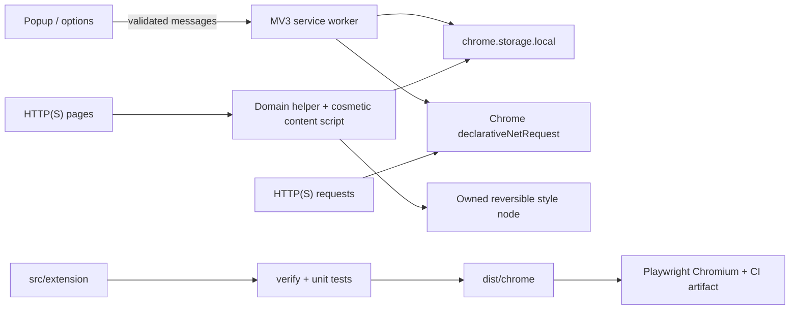

# Ad Blocker project handoff

> **Live operational handoff — 17 November 2026 (Asia/Kolkata).** This document was prepared from `main` at `652fe406b14c189b2f877a5e1528c4197e63ff35`. Always recheck the current SHA, open pull requests, issues, source, and exact-commit CI before starting work.

This is the primary handoff for a human or coding tool continuing the project. It records the main goal, verified features, limitations, purpose of every active file and folder, complete dependency-aware task queue, and the pull-request evidence that a reviewer must monitor.

The source of truth, in order, is:

1. Current `main` source and configuration.
2. Exact-commit tests and GitHub Actions results.
3. This handoff.
4. Topic documents under `docs/`.
5. Dated records under `docs/history/`.

If two documents disagree, inspect the live code and tests. Do not turn a planning statement into a shipped-feature claim.

## Start here

```bash
git status --short
git rev-parse HEAD
npm ci --cache /workspace/.cache/npm --no-audit --no-fund
git diff --exit-code -- package-lock.json
npm run check
npm run build
```

Use `npm run test:e2e` only where Playwright Chromium can be downloaded and unpacked extensions may be side-loaded. GitHub Actions is the current exact-commit browser evidence when a managed local machine blocks that operation.

### Non-negotiable project rules

- Preserve existing work and Git history. Never force-push or silently delete another contributor's work.
- `src/extension/` is the only active extension runtime.
- `AnalyseFuture/` is preservation quarantine. Do not install, build, test, execute, import, or promote anything from it without the full review gate in `AnalyseFuture/README.txt`.
- Do not add third-party code, filter data, assets, remote services, telemetry, permissions, or executable downloads without provenance, license, privacy, security, and maintainer review.
- The repository has no approved project-wide distribution license. A coding tool must not choose one.
- Do not publish to a browser store, pay fees, change repository visibility, or announce a production release without explicit owner approval.
- Do not claim universal blocking, zero breakage, exact production block counts, guaranteed YouTube/video-ad removal, or market leadership without reproducible evidence.
- One implementation task belongs in one focused pull request. A passing run for an older SHA is not evidence for a newer one.

## Main goal

Build an independently branded, privacy-first ad-blocking platform, beginning with a reliable Chrome Manifest V3 extension. The product should earn trust through measured blocking quality, low website breakage, minimal permissions, local-first settings, accessible controls, deterministic builds, safe filter updates, transparent limitations, and reproducible browser evidence.

Chrome is the current product boundary. Edge and Firefox require separately tested adapters. Mobile, desktop, and DNS protection would be separate products with their own architecture, consent model, security review, operating cost, and owner approval.

## Current project status

**Status:** development preview, not a production release.

- Baseline inspected: `652fe40` on `main`.
- Exact-main workflow: [GitHub Actions run 38](https://github.com/rejoansardar23/ad-blocker/actions/runs/44034393848), successful in 42 seconds.
- Automated inventory: 18 Node tests and ten page-level Playwright Chromium scenarios.
- Runtime dependencies shipped in the extension: none.
- Development dependency: Playwright 1.65.0, locked for browser testing.
- Active tracked files after this handoff is added: 60.
- Preserved quarantined files: 1,395; none participate in the active dependency graph.

### Implemented and evidence-backed features

| Feature | Current implementation | Evidence boundary / remaining limitation |
|---|---|---|
| Chrome MV3 package | Manifest, background worker, popup, options, content scripts, bundled DNR resource; Chrome 121 minimum | Loads in Playwright Chromium; manual Chrome Stable installation and permission UX remain open |
| Starter network blocking | Four static DNR rules covering eleven public ad/tracker domains plus `ads.adblocker.test` | The reserved fixture is browser-verified; this is not a production filter list or broad coverage claim |
| Global pause/resume | Persistent `enabled` setting controls static DNR and cosmetic filtering | Browser-verified through restart; API-failure consistency still needs tests |
| Trusted websites | Up to 100 normalized exact-domain entries; subdomains inherit trust through managed priority-100 `allowAllRequests` rules | Exact, subdomain, lookalike-domain, removal, reload, and restart cases are verified on synthetic fixtures |
| Settings integrity | Invalid stored state is repaired; sites are normalized, deduplicated, sorted, and capped; confirmed reset restores defaults | No explicit schema version or migration framework yet |
| Safe DNR reconciliation | Avoids redundant rewrites, repairs stale managed conditions, serializes DNR sync, and preserves unrelated dynamic rules | Complete settings mutations are not serialized; concurrent writes may lose an update |
| Basic cosmetic filtering | One owned stylesheet hides three narrow selector families and is removed on pause/trust | Reversible behavior is tested; no production cosmetic syntax, dynamic picker, or broad breakage corpus |
| Popup controls | Global/site switches, active-tab detection, reload, settings link, pending-write guard, rejected-save recovery | Node-tested behavior; the real toolbar popup is not opened by the Chromium suite and lacks a full accessibility audit |
| Options controls | Global toggle, validated trusted-site add/remove, local privacy/limitations copy, confirmed settings recovery | Browser fixture operates the options page; import/export, migrations, and live cross-view refresh are absent |
| Local-first privacy posture | Active runtime contains no server, remote executable script, request-content log, analytics, or telemetry implementation | A formal permission and outbound-traffic audit remains required |
| Reproducible validation | Frozen install, lockfile guard, structural checks, unit tests, clean build, dependency audit/SBOM, Chromium fixtures, CI artifacts | Synthetic loopback evidence is not broad public-site, performance, store, or Chrome Stable evidence |

### Not implemented or not proven

- Licensed production filter sources, filter parser/compiler, unsupported-syntax reporting, quota planning, and deterministic rule bundles.
- Integrity-checked list updates, staged activation, offline fallback, last-known-good rollback, and update incident response.
- User-defined rules, advanced exceptions, safe element picker, production cosmetics, tracker/nuisance modes, or regional packs.
- Live synchronization between already-open popup and options views.
- Correct rollback/convergence when Chrome DNR APIs fail after storage changes.
- Correct behavior for interleaved settings writes, service-worker suspension, and schema migration.
- Broad HTTPS/real-site compatibility, anti-adblock behavior, accessibility certification, privacy traffic capture, or performance budgets.
- Accurate production diagnostics, competitive benchmarks, signed release artifacts, Chrome Web Store readiness, or release support operations.
- Edge, Firefox, mobile, desktop, DNS, or guaranteed server-inserted video-ad handling.

## Current architecture



The browser, not JavaScript request interception, applies DNR rules. Popup/options messages go through the worker, and local settings drive both DNR reconciliation and cosmetic behavior. The build copies only `src/extension/` into `dist/chrome`; quarantine has no execution edge.

## Complete folder guide

| Folder | Purpose and boundary |
|---|---|
| `.github/` | Active GitHub workflow, issue forms, pull-request template, and review guidance |
| `.github/workflows/` | Root CI only; nested workflows in quarantine are inert and untrusted |
| `.github/ISSUE_TEMPLATE/` | Structured bug, feature, and research intake |
| `src/` | First-party application source collection |
| `src/extension/` | The only active, packaged Chrome extension source |
| `src/extension/background/` | Worker-owned state validation and DNR coordination |
| `src/extension/content/` | Page-side, narrowly scoped cosmetic behavior |
| `src/extension/shared/` | Dependency-free logic shared across extension contexts |
| `src/extension/rules/` | Packaged static DNR rules |
| `src/extension/popup/` | Toolbar action interface |
| `src/extension/options/` | Settings, trusted sites, and recovery interface |
| `scripts/` | First-party structural verification and deterministic build automation |
| `tests/unit/` | Fast Node tests for isolated logic and mocked extension contexts |
| `tests/browser/` | Real Playwright Chromium tests using controlled loopback fixtures |
| `docs/architecture/` | Current design, flows, constraints, and narrow design records |
| `docs/development/` | Setup, agent workflow, PR order, release gates, and contributor onboarding |
| `docs/governance/` | Architecture decisions, reuse/license rules, and audit templates |
| `docs/history/` | Dated handoffs and reconstructed project context; never live truth without rechecking |
| `docs/product/` | Vision, requirements, feature state, ordered checklist, and roadmap |
| `docs/research/` | Candidate studies, benchmark design, and unanswered research questions |
| `docs/security/` | Threat, privacy, permission, and security design records |
| `docs/testing/` | Test commands, browser scope, limitations, and exact evidence |
| `AnalyseFuture/` | Preserved uncertain/imported work; not active code and never safe to execute by default |
| `dist/` | Ignored generated unpacked extension produced by `npm run build` |
| `build/` | Ignored generated evidence such as dependency SBOM output |
| `node_modules/` | Ignored locally installed development dependencies |
| `.cache/`, `coverage/`, `playwright-report/`, `test-results/`, `.tmp/` | Ignored machine-specific caches and generated test output |

## Every active file and what it does

The following table covers every tracked file outside `AnalyseFuture/`, including this handoff.

### Root files

| File | Purpose |
|---|---|
| `.gitignore` | Keeps generated output, caches, credentials, keys, logs, and editor/OS files out of Git |
| `AGENTS.md` | Mandatory operating, testing, license, privacy, and evidence rules for coding agents |
| `CONTRIBUTING.md` | Contributor issue/branch/PR workflow and quality expectations; some browser-evidence wording is dated |
| `HANDOFF.md` | Current operational state, full repository guide, task queue, and PR monitoring contract |
| `PROJECT_IDEA.txt` | Detailed long-term product and AI-era research charter; a plan, not a shipped-feature list |
| `PROJECT_STRUCTURE.md` | Authoritative organization, dependency flow, old-to-new paths, quarantine boundary, and placement rules |
| `README.md` | GitHub homepage orientation and link to this handoff; some older evidence remains historical |
| `SECURITY.md` | Private vulnerability-reporting route and top-level security principles |
| `package.json` | Node 22+ project metadata, Playwright pin, and grouped verify/test/build/browser commands |
| `package-lock.json` | Integrity-locked Playwright and playwright-core dependency graph for reproducible development tests |

### GitHub automation and templates

| File | Purpose |
|---|---|
| `.github/workflows/checks.yml` | On pushes/PRs: frozen install, lockfile guard, SBOM, audit, checks, build, Playwright Chromium, browser smoke test, and artifacts |
| `.github/PULL_REQUEST_TEMPLATE.md` | Requires scope, reuse/license, exact tests, privacy/security effects, docs, limitations, and next task |
| `.github/CODEX_REVIEW_GUIDE.md` | Historical agent review/merge guidance; recheck its dated “next task” statements |
| `.github/ISSUE_TEMPLATE/bug_report.md` | Reproducible bug intake with browser/version details and private-security routing |
| `.github/ISSUE_TEMPLATE/feature_request.md` | Feature intake covering problem, alternatives, MV3/privacy/license effects, acceptance, and testing |
| `.github/ISSUE_TEMPLATE/research_task.md` | Evidence-first component/data research with immutable source and license details |

### Active extension runtime

| File | Purpose and implemented behavior |
|---|---|
| `src/extension/manifest.json` | MV3 package definition, Chrome 121 minimum, permissions, service worker, popup, options, content scripts, and starter DNR resource |
| `src/extension/background/service-worker.js` | Repairs/returns local state, validates messages, changes global/site settings, resets defaults, reconciles static/dynamic DNR rules, and syncs on install/start/storage changes |
| `src/extension/shared/domain.js` | Normalizes ordinary HTTP(S) DNS hostnames and tests exact/subdomain trusted-site membership; rejects credentials, wildcards, spaces, internal URLs, and IP literals |
| `src/extension/content/cosmetic.js` | Injects/removes one owned narrow CSS rule set according to enabled/trusted-site state without deleting page-owned nodes |
| `src/extension/rules/starter.json` | Four proof-of-concept static block rules, including the reserved browser-test domain |
| `src/extension/popup/popup.html` | Semantic toolbar UI for global protection, current-site protection, reload, and settings navigation |
| `src/extension/popup/popup.css` | Dark popup layout, toggle/status states, and visible keyboard focus styles |
| `src/extension/popup/popup.js` | Detects the active site, requests state, changes global/site settings, prevents overlapping saves, recovers rejected writes, reloads the tab, and opens options |
| `src/extension/options/options.html` | Settings page for global protection, trusted sites, confirmed recovery, privacy, and honest limitations |
| `src/extension/options/options.css` | Responsive settings layout with focus, disabled, error, and narrow-screen states |
| `src/extension/options/options.js` | Loads state, validates/adds/removes trusted sites, toggles protection, confirms reset, locks pending edits, and recovers after failed saves |

### Active scripts and tests

| File | Purpose and coverage |
|---|---|
| `scripts/verify.mjs` | Requires all 11 runtime files, parses manifest/rules, checks IDs/references/types, verifies JavaScript syntax, and rejects remote script tags in extension HTML |
| `scripts/build.mjs` | Runs verification, recreates `dist/chrome`, and copies only the active manifest and six runtime folders |
| `tests/unit/domain.test.mjs` | Two tests for hostname normalization/rejection and exact/subdomain/lookalike matching |
| `tests/unit/service-worker.test.mjs` | Nine tests for idempotent reads, state repair, exceptions, pause/resume, reset, invalid input, non-churn, stale-rule repair, and canonical equality |
| `tests/unit/cosmetic.test.mjs` | One test for owned-style lifecycle and preservation of a page-owned element |
| `tests/unit/settings-ui.test.mjs` | Six tests for options recovery/cancel and popup/options pending-write and rejected-save behavior |
| `tests/browser/chromium-smoke.mjs` | One real-browser script with ten page scenarios for blocking/control, pause/cosmetics, trust boundaries/removal, restart persistence, persisted pause, and reset recovery |

### Architecture and development documents

| File | Purpose |
|---|---|
| `docs/architecture/ARCHITECTURE.md` | Current runtime flow, permissions, privacy boundary, next increments, and open design questions |
| `docs/architecture/IDEMPOTENT_RULES.md` | Design record for canonical DNR comparison and safe owned-style behavior |
| `docs/development/START_HERE.md` | Short onboarding route for a contributor without chat history |
| `docs/development/DEVELOPER_SETUP.md` | Runtime prerequisites, install/build/test commands, unpacked loading, manual checks, and troubleshooting |
| `docs/development/CODEX_WORKFLOW.md` | Agent task selection, evidence, cost control, review, and done workflow |
| `docs/development/PR_EXECUTION_QUEUE.md` | Older issue dependency order and PR review protocol; reconcile with the live queue below |
| `docs/development/RELEASE_GUIDE.md` | Approval-gated alpha/beta/stable requirements, rollback, and platform boundaries |

### Governance and history documents

| File | Purpose |
|---|---|
| `docs/governance/DECISIONS.md` | Proposed/accepted ADRs and unresolved owner decisions, especially licensing and reuse |
| `docs/governance/REUSE_AND_LICENSES.md` | Component/filter evaluation policy, candidate notes, and no-import rules |
| `docs/governance/REUSE_AUDIT_TEMPLATE.md` | Reusable worksheet for one external component or dataset review |
| `docs/history/MASTER_PROJECT_HANDOFF.md` | Detailed 16 November snapshot of mission, old main/PR state, architecture, research pins, and roadmap |
| `docs/history/RESEARCH_AND_CHAT_HISTORY_ARCHIVE.md` | Reconstructed project conversation/research chronology, source links, and durable constraints |
| `docs/history/NEXT_CHAT_START.txt` | Copy/paste prompt tied to an older `main`; update its facts before using it |

### Product, research, security, and testing documents

| File | Purpose |
|---|---|
| `docs/product/VISION.md` | Mission, users, measurable success, principles, boundaries, and ownership posture |
| `docs/product/PRODUCT_SPEC.md` | Proposed use cases, numbered requirements, acceptance evidence, and definition of done |
| `docs/product/FEATURE_MATRIX.md` | Intended implemented/verified/planned status ledger; current counts/evidence need reconciliation |
| `docs/product/IMPLEMENTATION_CHECKLIST.md` | Ordered 60-task program from governance through platform expansion |
| `docs/product/ROADMAP.md` | Milestones, dependencies, exit gates, and prioritization mechanism |
| `docs/research/FOUNDATION_AUDIT.md` | Partial pinned comparison supporting retention of the original runtime while reuse is unresolved |
| `docs/research/OPEN_SOURCE_REFERENCE_REPOS.txt` | Canonical 18-project research catalog with roles, pins, and license leads |
| `docs/research/COMPETITIVE_BENCHMARK.md` | Future controlled comparison methodology and empty evidence scorecard |
| `docs/research/RESEARCH_BACKLOG.md` | Open legal, technical, product, and business questions plus a research-record format |
| `docs/security/SECURITY_PRIVACY.md` | Threat/privacy/permission checklist; its “no application code” statement is stale and must not be treated as live truth |
| `docs/testing/TESTING.md` | Current grouped commands, coverage, alpha gates, test pyramid, and benchmark integrity rules |
| `docs/testing/CHROMIUM_TEST_GUIDE.md` | Playwright extension setup, covered scenarios, limits, and managed-cloud constraints |
| `docs/testing/TEST_EVIDENCE.md` | Exact grouped results, browser evidence, local environment limitation, and untested areas for `ee0519f` |

## Quarantined material: preserved, not implemented

`AnalyseFuture/` contains 1,395 tracked files and has no edge in the active install, test, build, or release flow. Its internal upstream layouts are intentionally preserved rather than reorganized as first-party files.

| Quarantine collection | Why it exists |
|---|---|
| `AnalyseFuture/README.txt` | Status, provenance, archive hashes, risks, known licenses, and mandatory promotion gate |
| `AnalyseFuture/OriginalUploads/` | Two exact original ZIP inputs restored for forensic preservation |
| `AnalyseFuture/ImportedUpstream/projects/ghostery-adblocker/` | Intact ZIP-derived Ghostery tree; unknown authoritative upstream commit; MPL-2.0 declaration does not clear all contents/dependencies |
| `AnalyseFuture/ImportedUpstream/projects/ublock-origin/` | Intact ZIP-derived uBlock tree; unknown authoritative upstream commit; GPL-3.0-or-later declaration and data/assets require review |
| `AnalyseFuture/ImportedUpstream/docs/` | Frozen imported product-plan snapshot, not the active plan |
| `AnalyseFuture/ImportedUpstream/scripts/` | Inactive archive/import/build utilities that may invoke network or child processes |
| `AnalyseFuture/ImportedUpstream/tests/` | Preserved upstream-adapter tests, not part of root test commands |
| `AnalyseFuture/ImportedUpstream/root-integration/` | Frozen disrupted-state README/package/workflow files with obsolete paths and activation risk |

Do not enumerate or treat every quarantined upstream internal file as a project feature. `PROJECT_STRUCTURE.md`, `AnalyseFuture/README.txt`, and the recorded snapshot hashes are the safe inventory. Promotion requires an immutable upstream identity, content comparison, file/data/dependency license audit, security review, demonstrated need, scoped integration/rollback design, tests, and explicit maintainer approval.

## Test groups and current evidence

| Group | Command | Current evidence |
|---|---|---|
| Structure and syntax | `npm run verify` | Required files, JSON, MV3 references, JS syntax, and remote-script guard pass |
| Unit behavior | `npm run test:unit` | 18/18 pass: 2 domain, 9 worker/DNR, 1 cosmetic, 6 popup/options |
| Combined local checks | `npm run check` | Structure plus all unit behavior pass |
| Package | `npm run build` | Creates 11-file `dist/chrome` from the 11-file active source package |
| Browser | `npm run test:e2e` | Builds first, then runs ten controlled Playwright Chromium scenarios |
| Full active pipeline | `npm run test:all` | Check, build, and browser groups in dependency order |
| Supply chain | GitHub Actions | Frozen install, lockfile guard, high-severity audit, CycloneDX SBOM, and artifacts |

See [grouped evidence](docs/testing/TEST_EVIDENCE.md). The successful suite is a strong development baseline, not proof of broad real-world compatibility or production readiness.

## Live GitHub state at this handoff

- Fourteen issues are open: [#1](https://github.com/rejoansardar23/ad-blocker/issues/1), [#2](https://github.com/rejoansardar23/ad-blocker/issues/2), and [#5–#16](https://github.com/rejoansardar23/ad-blocker/issues).
- Issue #1 still asks to establish the Chromium baseline, but that baseline now exists. Reconcile or close it only after checking all of its acceptance criteria.
- Exactly one pull request is open: draft [PR #20](https://github.com/rejoansardar23/ad-blocker/pull/20), head `13176deab7b2b54d7149f67e2f85247ab16b195c`, last updated 15 November 2026.
- PR #20 implements live settings-view synchronization plus a large research/doc bundle. Its old CI passed, but its base predates settings recovery, the complete reorganization, project vision, and grouped testing work. Do not merge it from the old green run. Compare it against current paths, preserve attribution, and either rebase/split it or create a fresh focused current-main PR.
- Current `main` does **not** contain PR #20's cross-view synchronization.

## Complete dependency-ordered task queue

Status meanings: **Ready** can start from current `main`; **Blocked** needs a dependency or owner decision; **Future** must wait for earlier product evidence; **Owner** cannot be decided by a coding tool.

### Immediate core and alpha work

| ID | Status / dependency | Deliverable and acceptance evidence |
|---|---|---|
| `CORE-01` | **Ready** | Implement live popup/options synchronization as a focused current-main PR. External storage changes refresh both views; pending edits and stale responses are protected; Node tests cover both UIs; Chromium opens two extension views and proves sync. Compare PR #20 but do not carry unrelated research into the feature PR. |
| `CORE-02` | **Ready after or alongside CORE-01** | Serialize complete settings mutations, not only DNR reconciliation. Interleaved add/add, add/remove, toggle/site, and reset/site operations produce deterministic results; a rejected operation does not poison the queue; regression tests reproduce and fix the lost-update race. |
| `CORE-03` | **Blocked by CORE-02** | Make storage/DNR failure behavior consistent. Inject failures from enabled-ruleset and dynamic-rule APIs; UI reports the failure honestly; status does not claim unapplied protection; retry/restart converges; unrelated browser rules remain intact. |
| `CORE-04` | **Blocked by CORE-02/03** | Add a versioned settings schema and migrations. Preserve current data, safely repair corrupt/partial state, define future-version behavior, and test install/startup/storage changes after worker suspension. |
| `QA-01` | **Blocked by CORE-01–04** | Manual Chrome Stable, permission, privacy, and accessibility gate: exact OS/browser/version, actual toolbar popup and options, keyboard/focus/labels/contrast/screen reader, pause/trust/reload/restart, permission disclosure, service-worker console, and outbound-traffic capture. File every failure as a scoped issue. |
| `ALPHA-01` | **Blocked by QA-01** | Create a deterministic developer alpha ZIP containing only the verified extension; compare two clean builds, publish SHA-256, test install/update/uninstall/rollback, and document limitations. Public distribution remains owner-gated. |
| `DOCS-01` | **Ready, separate docs PR** | Reconcile stale current docs with live code/evidence without rewriting history: feature matrix, checklist, security/privacy, contributor guide, agent guide, research backlog, issue #1 status, and exact CI/test counts. Keep dated history explicitly dated. |

### Governance, data, and filtering foundation

| ID | Status / dependency | Deliverable and acceptance evidence |
|---|---|---|
| `GOV-01` | **Owner** | Owner chooses project license, contributor terms, distribution model, brand/trademark path, and store-account ownership. Record a signed-off decision; tools must not infer it. |
| `GOV-02` | **Blocked by GOV-01** | Complete pinned source/data/dependency/license/security audit and approve one architecture ADR. Compare KEEP/INTEGRATE/ADAPT/BUILD/DEFER/REJECT; reject overlapping engines without measured value; do not promote quarantine. |
| `DATA-01` | **Blocked by GOV-01/02** | Create a filter-source registry with exact origin, version/hash, license/notice, redistribution decision, update cadence, owner, and fixture/production separation for every source. |
| `COMP-01` | **Blocked by DATA-01** | Build or approve one deterministic list-to-DNR compiler. Define supported syntax, report every unsupported construct, produce stable hashes, deduplicate, enforce priority/ID ownership and quotas, and test malformed plus legitimate-control input. |
| `FILTER-01` | **Blocked by COMP-01** | Add baseline tracker handling with defined first-/third-party policy, controlled tracker fixtures, legitimate controls, coverage/breakage results, and DNR-budget evidence. |
| `COSMETIC-01` | **Blocked by COMP-01** | Add safe production cosmetics with dynamic-DOM tests, exceptions, reversibility, page-owned-content protection, accessibility checks, and performance limits. |
| `REGION-01` | **Blocked by DATA-01/COMP-01** | Add opt-in regional/language packs only with provenance, a qualified reviewer, wanted-content controls, a regional corpus, measured breakage, and a sustainable update owner. |
| `RULES-01` | **Blocked by COMP-01/CORE-04** | Add custom blocking/allow rules with preview, strict validation, precedence/conflict explanation, undo, persistence, and invalid-input tests. Never silently accept unsupported syntax. |
| `PICKER-01` | **Blocked by COSMETIC-01/RULES-01** | Add an accessible reversible element picker with stable minimal selector generation, preview/cancel/undo, keyboard use, legitimate-control safety, and dynamic-page browser tests. |
| `UPDATE-01` | **Blocked by DATA-01/COMP-01** | Add provenance/integrity/version checks, staged promotion, corrupted/truncated/wrong-version rejection, offline startup, last-known-good rollback, and a documented rollback drill. Remote endpoint approval is required. |

### Product maturity, proof, and release

| ID | Status / dependency | Deliverable and acceptance evidence |
|---|---|---|
| `REPORT-01` | **Blocked by stable rules** | Privacy-safe breakage reporting with local preview/redaction, explicit opt-in, cancellation/deletion, and no raw history, cookies, credentials, or page contents by default. Any server/retention policy requires owner approval. |
| `PROFILE-01` | **Blocked by FILTER-01/REGION-01** | Clearly separated tracker/nuisance profiles with visible source/version, opt-in controls, false-positive corpus, and per-profile rollback. |
| `PRIVACY-01` | **Blocked by stable core** | Audit every permission/content script and actual outbound traffic; inventory stored data; minimize access; update threat model; remediate high-risk findings. |
| `UX-01` | **Blocked by stable settings/filter core** | Accessible simple/expert dashboard with keyboard/screen-reader task completion, visible errors, recovery, and browser regressions. |
| `SETTINGS-01` | **Blocked by CORE-04/RULES-01** | Strict versioned import/export, backup/restore/reset, safe parsing, migration, rollback, and malicious/corrupt fixture coverage. |
| `DIAG-01` | **Blocked by stable filtering pipeline** | Honest MV3 diagnostics for versions, quotas, errors, and browser-supported facts only; never invent universal block counts. |
| `PERF-01` | **Blocked by representative corpus** | Measure no-extension baseline versus product for page load, CPU, memory, startup, battery proxy, rule footprint, and long-lived DOM; record repeated distributions and enforce budgets. |
| `BUILD-01` | **Blocked by UPDATE-01/PERF-01** | Reproducible clean-build hash comparison, pinned toolchain, SBOM, notices, checksums/signing design, release notes, and artifact rollback path. |
| `POLICY-01` | **Blocked by PRIVACY-01/DIAG-01** | Publish owner/legal-approved privacy policy, permissions/limitations disclosure, and support/incident process that match actual data flows. |
| `SEC-01` | **Blocked by PRIVACY-01/BUILD-01/UPDATE-01** | Internal threat, supply-chain, update, content-script, storage, and release review; severity triage; high-priority remediation; exact-commit retest. |
| `RELEASE-01` | **Owner; blocked by all release gates** | Prepare Chrome Web Store assets/disclosures and staged rollout/rollback plan. Submission, account use, payment, and publication require explicit owner approval. |
| `BENCH-01` | **Blocked by feature candidate** | Pin browser, hardware, competitors, versions, and filter configurations; define identical synthetic and privacy-safe representative-site workloads. |
| `BENCH-02` | **Blocked by BENCH-01** | Measure coverage, wanted-content precision, breakage, CPU/memory/load/reliability distributions; repair/retest; publish methods, uncertainty, and omissions without unsupported superiority claims. |
| `OPS-01` | **Blocked by controlled alpha** | Establish consensual feedback, severity triage, update cadence, incident response, regional/list ownership, and time-to-reproduce/repair metrics. |

### Later platform and research work

| ID | Status / dependency | Deliverable and acceptance evidence |
|---|---|---|
| `PLATFORM-01` | **Future after stable Chrome release** | Separate Edge and Firefox adapters, manifests, permissions, packaging/signing, and browser matrices; independent go/no-go ADR for each. |
| `VIDEO-01` | **Future after stable core and legal/API review** | Separate network ads, overlays, sponsorship, and server-inserted streams in a version/account/region corpus; protect playback; publish stop conditions; never promise universal removal. |
| `FUTURE-01` | **Owner / future** | Independent mobile, desktop, and DNS feasibility ADRs covering architecture, threat model, consent, operations, cost, staffing, and maintenance. The extension cannot provide device-wide filtering by itself. |

### Recommended work for the next coding tool

Start with `CORE-01` unless the maintainer assigns a different unblocked task. The tool must inspect current `main` and draft PR #20, preserve useful attribution, and open a focused current-main pull request containing only settings-view synchronization and its tests. It must not merge PR #20 wholesale or execute anything in `AnalyseFuture/`.

After `CORE-01`, the safe reliability order is:

```text
CORE-01 -> CORE-02 -> CORE-03 -> CORE-04 -> QA-01 -> ALPHA-01
```

Governance can proceed in parallel with owner participation, but external filter data/compiler work must wait for `GOV-01`, `GOV-02`, and `DATA-01`.

## Pull-request handoff contract

The other coding tool should:

1. Pull current `main` and record the full baseline SHA.
2. Select exactly one unblocked task ID from this handoff.
3. Create one focused branch and one pull request; do not combine unrelated research, cleanup, feature, and restructuring work.
4. Include task ID, issue, baseline/head SHA, changed files, behavior before/after, license/reuse analysis, permissions/privacy/security impact, exact commands/results, browser version, limitations, and rollback in the PR body.
5. Add a regression that fails for the old behavior where practical, plus legitimate negative controls.
6. Keep `AnalyseFuture/` untouched and unexecuted.
7. Avoid silent dependencies, permissions, endpoints, telemetry, filter data, licensing, or release changes.
8. Update the feature matrix/checklist only for evidence actually produced.

Required evidence for an implementation PR:

```bash
npm ci --no-audit --no-fund
git diff --exit-code -- package-lock.json
npm run check
npm run build
npm run test:e2e
```

If local Chromium is policy-blocked, report that as an environment limitation and require the exact-head GitHub Actions browser step. Do not weaken the harness to manufacture a local pass.

## Monitoring and review protocol

When the new PR exists, the reviewer should move it through these explicit states:

```text
Awaiting PR -> Scope review -> Code/security/license review -> Tests running
-> Changes requested or Exact-head CI green -> Approved -> Maintainer merge decision
```

For every update to the PR head, repeat these checks:

- Confirm base/head SHAs and that the branch is current enough to review safely.
- Confirm the diff implements one task ID and contains no unrelated deletion or quarantine activation.
- Inspect every dependency, manifest permission, network endpoint, data flow, imported asset, and license effect.
- Verify the regression genuinely exercises the bug/feature and includes positive plus negative controls.
- Run or inspect frozen install, lockfile guard, `npm run check`, `npm run build`, relevant browser tests, audit/SBOM, and exact-head CI.
- Treat old successful runs as obsolete after any push.
- Check that documentation distinguishes source presence, unit evidence, browser evidence, manual evidence, and remaining gaps.
- Request a split if code, unrelated research, bulk formatting, or multiple task IDs are mixed.
- Do not approve or merge while owner-only decisions, failing checks, unresolved review findings, or unexplained permission/data/license changes remain.

Monitoring starts when a PR URL or number is available in an active session. No AI process watches GitHub after its session ends automatically; the durable state must live in the PR conversation, checks, and this repository.

## Definition of done

A task is complete only when all applicable items are true:

- Focused source is merged from a reviewed PR.
- Positive, negative, failure, and recovery regressions pass.
- The exact final commit has green CI; the browser version and environment are recorded.
- Browser-specific behavior has real browser evidence, not mocks alone.
- Security, privacy, permissions, source/data licenses, and supply-chain effects are reviewed.
- The build is reproducible and contains only intended active files.
- Feature matrix, checklist, handoff/task status, and limitations match the evidence.
- Failure behavior, rollback, and user recovery are documented.
- No unrelated work is deleted and quarantine remains preserved/inactive.

## Known documentation debt

Do not silently delete or rewrite these records. Address them through `DOCS-01` with review:

- `README.md` contains older CI links and an obsolete statement that CI has not proved browser filtering.
- `docs/product/FEATURE_MATRIX.md`, `docs/product/IMPLEMENTATION_CHECKLIST.md`, and `docs/research/FOUNDATION_AUDIT.md` cite older test counts/evidence.
- `docs/security/SECURITY_PRIVACY.md` incorrectly says there is no application code.
- `CONTRIBUTING.md`, `.github/CODEX_REVIEW_GUIDE.md`, `docs/development/CODEX_WORKFLOW.md`, and `docs/research/RESEARCH_BACKLOG.md` contain older browser/next-task statements.
- `docs/history/*` and `docs/history/NEXT_CHAT_START.txt` intentionally describe dated main/PR snapshots; retain them as history but never use them as live status without rechecking.
- Open issue #1 is partly superseded by the verified Chromium baseline and needs evidence-based reconciliation.

## Canonical references

- [Project structure and quarantine boundary](PROJECT_STRUCTURE.md)
- [Detailed long-term project idea](PROJECT_IDEA.txt)
- [Current architecture](docs/architecture/ARCHITECTURE.md)
- [Feature matrix](docs/product/FEATURE_MATRIX.md)
- [Ordered 60-task checklist](docs/product/IMPLEMENTATION_CHECKLIST.md)
- [Roadmap](docs/product/ROADMAP.md)
- [Testing strategy](docs/testing/TESTING.md)
- [Exact grouped test evidence](docs/testing/TEST_EVIDENCE.md)
- [Security reporting](SECURITY.md)
- [Agent rules](AGENTS.md)
- [Contribution guide](CONTRIBUTING.md)
- [Quarantine warning and provenance](AnalyseFuture/README.txt)

The immediate engineering objective is not “add every possible blocker feature.” It is to make the existing Chrome core consistent under concurrency and API failure, verify it manually and accessibly, resolve ownership/license gates, and only then add one legally reviewed, deterministic filtering pipeline with safe updates and measurable compatibility.
