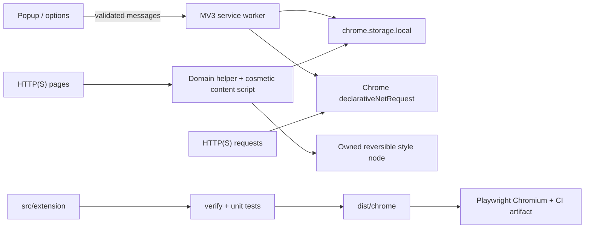

# Ad Blocker project handoff

## Recovery mission checkpoint — 18 November 2026

The mission baseline `ce77ac5` is preserved on remote `recovery/pre-mission-ce77ac5`. The owner subsequently directed delivery straight to `main`; no mission PR is required by that instruction.

The [integrity investigation](docs/security/REPOSITORY_INTEGRITY_AUDIT.md) confirms disruptive imports/document removal and prior archive-code activation, with no evidence sufficient to attribute unauthorized account access. The [complete static inventory](docs/audit/REPOSITORY_AUDIT.md) accounts for all 1,455 baseline files and 11 duplicate groups. All imported-file/archive hashes match their local records; upstream identity and licensing remain unresolved. Run `npm run audit:repository` for the current inventory; CI saves its JSON/CSV reports as an artifact.

The [pre-change baseline](docs/testing/BASELINE_TEST_REPORT.md) passed locally, including ten real Chromium scenarios on 158.0.8127.18. [Structure decisions](docs/architecture/STRUCTURE_MIGRATION_PLAN.md) retain the active runtime layout. New repository checks prevent literal package-boundary escapes, broken active documentation links, tracked generated/credential-format files, and reactivation of quarantined root commands. Regex checks are guardrails, not a comprehensive security proof.

Next: consolidate verified redundant documentation, then port and regression-test PR #20's useful settings-view synchronization into current paths. Concurrency, DNR/storage failure convergence, manual Stable/accessibility, real-site coverage, and performance remain open.

> **Live operational handoff — 17 November 2026 (Asia/Kolkata).** This update was prepared from validated `main` commit `215bd5c59087393763cef74d42ca5f269e28367a`. Always recheck the current SHA, open pull requests, issues, source, and exact-commit CI before starting work.

This is the primary handoff for a human or coding tool continuing the project. It records the main goal, verified features, limitations, purpose of every active file and folder, complete dependency-aware task queue, and the pull-request evidence that a reviewer must monitor.

The source of truth, in order, is:

1. Current `main` source and configuration.
2. Exact-commit tests and GitHub Actions results.
3. This handoff.
4. Topic documents under `docs/`.
5. Dated records under `docs/history/`.

If two documents disagree, inspect the live code and tests. Do not turn a planning statement into a shipped-feature claim.

## Start here

```bash
git status --short
git rev-parse HEAD
npm ci --cache /workspace/.cache/npm --no-audit --no-fund
git diff --exit-code -- package-lock.json
npm run check
npm run build
```

Use `npm run test:e2e` only where Playwright Chromium can be downloaded and unpacked extensions may be side-loaded. GitHub Actions is the current exact-commit browser evidence when a managed local machine blocks that operation.

### Non-negotiable project rules

- Preserve existing work and Git history. Never force-push or silently delete another contributor's work.
- `src/extension/` is the only active extension runtime.
- `AnalyseFuture/` is preservation quarantine. Do not install, build, test, execute, import, or promote anything from it without the full review gate in `AnalyseFuture/README.txt`.
- Do not add third-party code, filter data, assets, remote services, telemetry, permissions, or executable downloads without provenance, license, privacy, security, and maintainer review.
- The repository has no approved project-wide distribution license. A coding tool must not choose one.
- Do not publish to a browser store, pay fees, change repository visibility, or announce a production release without explicit owner approval.
- Do not claim universal blocking, zero breakage, exact production block counts, guaranteed YouTube/video-ad removal, or market leadership without reproducible evidence.
- One implementation task belongs in one focused pull request. A passing run for an older SHA is not evidence for a newer one.

## 0. Prior work already available — preserve and build on it

Do not restart this project as an empty repository. A substantial foundation has already been implemented, recovered, organized, tested, documented, and pushed to `main`:

- one active original-code Chrome MV3 extension under `src/extension/`;
- browser-native starter DNR blocking, global pause, trusted-site exceptions, narrow cosmetics, popup, options, local repair, and reset;
- deterministic verification and packaging that copy only the active extension into `dist/chrome`;
- 18 Node regression tests and ten real Playwright Chromium page scenarios;
- frozen dependency installation, lockfile validation, audit, SBOM, CI artifacts, and exact-commit browser evidence;
- a professional functionality-based source, test, automation, and documentation layout;
- preservation of disrupted/imported work under `AnalyseFuture/` without activating or deleting it;
- a detailed product charter, architecture, 60-task program, research catalog, security rules, test evidence, and contribution workflow;
- direct `main` history for recovery, restructuring, project vision, grouped tests, and this handoff.

### Durable milestones already completed

| Milestone | Preserved result |
|---|---|
| `5ec7cd4` | Original Chrome MV3 preview, starter rules, UI, worker, tests, and 60-step roadmap |
| [PR #3](https://github.com/rejoansardar23/ad-blocker/pull/3) | Real Playwright Chromium blocking/allowlist baseline and locked browser dependency |
| [PR #4](https://github.com/rejoansardar23/ad-blocker/pull/4) | Idempotent DNR reconciliation and safe owned cosmetic styles |
| `10c8770` and related merge history | Reconciled upstream/fork regression, audit, SBOM, and documentation work |
| `c68d861` | Malformed-state repair and confirmed settings reset/recovery |
| `e5260c9` | Complete functionality-based active/quarantine repository organization without deleting preserved work |
| `560a485` | Detailed evidence-driven product and multi-year research charter |
| `ee0519f` | Grouped active commands and build-first E2E protection against stale packages |
| `652fe40` | Exact grouped test evidence and environment boundaries |
| `215bd5c` | Complete live handoff, 60-file inventory, task queue, and PR monitoring contract; [CI run 39](https://github.com/rejoansardar23/ad-blocker/actions/runs/44045637804) passed |

The next tool must first understand and protect this baseline. It should improve one proven boundary at a time, retain useful attribution, and avoid replacing working code merely to create activity. The implemented-feature table, complete file inventory, task queue, structure audit, and testing backlog below define what can be reused and what still needs work.

## 1. Complete project idea and ultimate ambition

### The idea in one sentence

Build a local-first, privacy-first protection platform that begins as a dependable Chrome Manifest V3 extension, blocks as much advertising and tracking as each target platform lawfully and safely permits, minimizes damage to wanted content, gives users reversible controls and recovery, and earns every claim through exact-version evidence.

### How to interpret “block ads everywhere”

The owner's ultimate ambition includes ordinary websites, dynamic web applications, YouTube and other video platforms, regional sites, browser-based apps, native applications, and network traffic. This is the direction for a family of products and research programs. It is not a technically valid promise that one browser extension can block every ad.

| Target | Correct product form | Realistic objective | Important boundary |
|---|---|---|---|
| Chrome websites and web apps | Current MV3 extension | Browser-native DNR blocking, safe cosmetics, local controls, licensed lists, custom rules, safe updates, and recovery | MV3 APIs, rule quotas, permissions, encrypted traffic, and store policy limit what the extension can observe or change |
| YouTube and other video sites | Category-specific browser research | Best-effort blocking of tested, distinguishable network ads, overlays, companion banners, and client-side categories without harming playback | Ads inserted into the same authenticated or encrypted stream as wanted video may be technically indistinguishable |
| Edge | Separately packaged Chromium adapter | Reuse proven modules where compatible, with its own store, permission, enterprise-policy, and regression evidence | Chromium similarity does not prove identical packaging or behavior |
| Firefox | Firefox-specific adapter | Use Firefox-supported filtering APIs with a separate manifest, implementation boundary, and test matrix | Chrome MV3 behavior cannot be assumed to match Firefox |
| Safari and mobile browsers | Separate platform feasibility projects | Use only approved content-blocking/extension capabilities within privacy, battery, signing, and policy budgets | APIs, background execution, distribution, and review rules differ materially by platform |
| Native mobile and desktop apps | Separate local product using OS-approved filtering APIs where feasible | Protect opted-in application/device traffic with clear consent, local control, updates, and recovery | A Chrome extension cannot filter arbitrary native-app traffic; encrypted app content often cannot be classified safely |
| DNS or network-wide protection | Separate DNS/network product | Domain-level protection for opted-in devices and networks | DNS cannot provide page cosmetics, distinguish paths on shared domains, or guarantee app compatibility; it needs privacy-safe operations and support |
| Creator sponsorship segments | Optional separately approved feature | User-controlled skipping only if API/database rights, consent, accuracy, and policy are clear | Sponsorship skipping is not ordinary request blocking and must not be silently bundled |
| Smart TVs, routers, and embedded devices | Future network/platform research | Apply only supported DNS, router, or platform mechanisms with device-specific testing | Hardware, certificates, updates, consent, recovery, and vendor restrictions require separate engineering |

The shared platform should provide governance, provenance, deterministic rule production, evidence standards, privacy principles, user expectations, and safe-update methods. It must not pretend that one codebase, permission set, or filtering technique works everywhere.

### Technical ad-category model

“Ads” are not one technical class. Each category needs a lawful mechanism, versioned corpus, wanted-content controls, owner, metrics, and stop conditions.

| Category | Candidate mechanism | Core limitation |
|---|---|---|
| Third-party network ads/trackers | Browser DNR, approved DNS/network rules | Coverage depends on accurate maintained domains/rules; shared infrastructure can create false positives |
| First-party or same-host requests | Carefully scoped URL/rule patterns and site-specific evidence | Blocking a host/path shared with wanted content can break the site |
| DOM banners, overlays, placeholders | Reviewed cosmetic selectors and reversible page-side behavior | Visual structure changes often; selectors can hide legitimate controls/content |
| Dynamically inserted SPA content | Bounded dynamic cosmetic handling and navigation-aware tests | Continuous DOM observation can cost CPU and cause race/breakage issues |
| Video companion ads/overlays | Network plus cosmetic rules for explicitly tested versions | Account, region, experiment, and player changes can invalidate rules |
| Client-inserted ad media | Category-specific request/manifest logic where browser APIs expose a safe distinction | Media manifests and playback integrity vary and can be authenticated |
| Server-side inserted video | Research only when a reproducible signal distinguishes ad from wanted media | Identical encrypted/authenticated stream bytes may make reliable separation impossible |
| Creator sponsorships | Optional user-controlled segment data after separate API/database review | Not ordinary ad blocking; accuracy, licensing, consent, and community moderation matter |
| Native in-app advertising | Separate OS-approved app/network product | Browser extensions have no authority over other apps; encrypted/same-host traffic remains hard |
| Tracking, cookie banners, and nuisances | Separate transparent profiles with source attribution and breakage tests | Users have different expectations; aggressive rules can remove consent or required UI |

### Product pillars

1. **Effective measured protection:** maximize reproducible ad and tracker coverage within the real capabilities of each platform.
2. **Wanted-content safety:** treat broken checkout, login, article, player, accessibility, download, payment, or security controls as serious defects.
3. **Privacy by default:** ordinary filtering and settings stay local; there is no browsing-history business model or silent upload of page data.
4. **Reversible control:** global pause, per-site trust, preview, undo, reset, last-known-good rollback, clear errors, and recovery are first-class features.
5. **One coherent pipeline:** approve one filtering architecture instead of combining overlapping engines without measured benefit.
6. **Legal provenance:** record immutable source identity, code/data/asset licenses, notices, dependencies, and redistribution approval.
7. **Secure delivery:** version, validate, integrity-check, stage, observe, and roll back every filter or application update.
8. **Accessibility and efficiency:** support keyboard/screen-reader use and enforce CPU, memory, page-load, battery, and package/rule-size budgets.
9. **Global coverage earned region by region:** every language/region needs approved sources, a representative corpus, qualified review, an owner, and sustainable maintenance.
10. **Evidence over marketing:** distinguish source presence, unit evidence, bundled-browser evidence, manual Stable-browser evidence, public-site evidence, experiments, and future ideas.

### Target platform architecture

```text
approved code and filter sources
  -> provenance and license registry
  -> deterministic parser/compiler
  -> syntax, conflict, quota, security, and integrity validation
  -> versioned candidate rule/data bundle
  -> compatibility, accessibility, privacy, and performance gates
  -> staged release
  -> platform-specific enforcement adapter
       -> Chrome / Edge / Firefox / Safari browser products
       -> separately approved mobile / desktop / DNS products
  -> local diagnostics and reversible controls
  -> last-known-good rollback and incident response
```

The architecture should develop as six connected layers:

- **Enforcement:** browser-native DNR and narrow cosmetics now; independently approved browser, OS, or DNS adapters later.
- **Local policy:** one validated, versioned state model for protection, site trust, profiles, custom rules, migrations, import/export, and recovery.
- **Rule production:** licensed inputs become deterministic bundles with stable hashes, unsupported-syntax reports, priority rules, deduplication, and quota reports.
- **Safe delivery:** candidate bundles receive integrity checks, staged promotion, offline fallback, observation, and tested rollback.
- **Compatibility laboratory:** synthetic and consent-respecting representative tests measure blocking, wanted-content preservation, accessibility, regions, privacy, performance, and recovery.
- **Optional AI assistance:** AI may suggest issue groups, tests, rules, or explanations, but deterministic validation, privacy/license review, human approval, canaries, and rollback remain mandatory.

### Delivery horizons

| Horizon | Focus | Required exit evidence |
|---|---|---|
| Current–12 months | Stabilize Chrome settings/DNR behavior, manual Chrome/accessibility/privacy review, owner licensing decisions, approved filter registry/compiler, and developer alpha | Reproducible Chrome build, exact-version browser evidence, no critical fixture failures, known legal boundary, tested recovery |
| 12–24 months | Mature filtering, safe updates/rollback, custom rules, dynamic cosmetics, regional packs, compatibility/performance corpus, and controlled Chrome release | Proven provenance, rollback drills, dated coverage/breakage/performance results, accessible UX, supported release operations |
| 24–36+ months | Edge/Firefox adapters, category-specific video research, privacy-safe AI assistance, and separate Safari/mobile/desktop/DNS feasibility | Independent go/no-go ADR, threat model, accountable owner, cost model, platform tests, stop conditions, and maintenance plan for every target |

### AI-era role

AI can assist with redacted issue grouping, deterministic fixture generation, candidate rule suggestions, unsupported-syntax explanations, documentation, localization drafts, accessibility review prompts, and regional coverage-gap research. Every output remains a proposal until reviewed against versioned data and deterministic tests.

AI must not autonomously publish rules or releases, approve licenses, promote quarantined code, expand permissions, spend money, or send URLs, browsing history, page text, screenshots, cookies, credentials, or account state to a remote model by default. Experiments need an owner, hypothesis, baseline, privacy/security/license review, success threshold, stop conditions, cost budget, human approval, and rollback.

### Product success metrics

| Area | Measure |
|---|---|
| Protection | Blocking recall by named category, site corpus, list version, browser, region, and account state |
| Wanted-content safety | Precision plus severity-weighted breakage of navigation, login, payment, media, accessibility, and other legitimate workflows |
| Recovery | Time and user steps to pause, trust a site, undo a rule, reset settings, restore last-known-good data, and recover from a failed update |
| Performance | Startup, page load, CPU, memory, long-lived DOM, battery proxy, package/list size, and rule-compilation/update cost |
| Browser capacity | Static/dynamic/session DNR quota use, rejected rules, unsupported syntax, and graceful overflow behavior |
| Reliability | Update success, rollback success, offline startup, crash/divergence rate, and soak-test results |
| Privacy/security | Unexpected outbound requests, stored-data inventory, permission scope, high-risk findings, dependency provenance, and incident response |
| Accessibility | Keyboard and screen-reader task completion, focus/announcement quality, contrast, zoom/reflow, and error recovery |
| Global coverage | Measured language/region coverage, qualified reviewer agreement, false positives, and sustainable maintenance ownership |
| Operations | Time to reproduce/repair, release rollback time, support load, infrastructure cost, and owner capacity |

Numerical release targets should be set only after a reproducible baseline exists; invented targets or counts are not evidence.

### What the project can promise

The responsible promise is: pursue the broadest useful protection that can be measured on each supported platform, preserve wanted content, investigate reproducible misses and breakage, keep normal operation private and reversible, recover safely, and state limitations honestly.

### What the project cannot promise

- Permanent 100% blocking on every website, application, language, browser, device, account state, region, or future delivery method.
- Universal YouTube/video-ad removal when advertising and wanted media are technically indistinguishable.
- Zero false positives, zero website/app breakage, zero maintenance, or permanent invisibility to anti-block systems.
- Device-wide native-app filtering from a browser extension.
- Automatic parity across Chrome, Edge, Firefox, Safari, Android, iOS, desktop, DNS, routers, and smart TVs.
- Exact universal blocked-ad counters when production APIs do not expose every required event.
- Autonomous AI-generated rules, source imports, model changes, or releases without deterministic checks and accountable human approval.
- Paywall, DRM, browser-security, account-control, consent, certificate-security, or store-policy circumvention.

## Current project status

**Status:** development preview, not a production release.

- Baseline used for this update: `215bd5c` on `main`.
- Exact-baseline workflow: [GitHub Actions run 39](https://github.com/rejoansardar23/ad-blocker/actions/runs/44045637804), successful in 37 seconds.
- Automated inventory: 18 Node tests and ten page-level Playwright Chromium scenarios.
- Runtime dependencies shipped in the extension: none.
- Development dependency: Playwright 1.65.0, locked for browser testing.
- Active tracked files after this handoff is added: 60.
- Preserved quarantined files: 1,395; none participate in the active dependency graph.

### Implemented and evidence-backed features

| Feature | Current implementation | Evidence boundary / remaining limitation |
|---|---|---|
| Chrome MV3 package | Manifest, background worker, popup, options, content scripts, bundled DNR resource; Chrome 121 minimum | Loads in Playwright Chromium; manual Chrome Stable installation and permission UX remain open |
| Starter network blocking | Four static DNR rules covering eleven public ad/tracker domains plus `ads.adblocker.test` | The reserved fixture is browser-verified; this is not a production filter list or broad coverage claim |
| Global pause/resume | Persistent `enabled` setting controls static DNR and cosmetic filtering | Browser-verified through restart; API-failure consistency still needs tests |
| Trusted websites | Up to 100 normalized exact-domain entries; subdomains inherit trust through managed priority-100 `allowAllRequests` rules | Exact, subdomain, lookalike-domain, removal, reload, and restart cases are verified on synthetic fixtures |
| Settings integrity | Invalid stored state is repaired; sites are normalized, deduplicated, sorted, and capped; confirmed reset restores defaults | No explicit schema version or migration framework yet |
| Safe DNR reconciliation | Avoids redundant rewrites, repairs stale managed conditions, serializes DNR sync, and preserves unrelated dynamic rules | Complete settings mutations are not serialized; concurrent writes may lose an update |
| Basic cosmetic filtering | One owned stylesheet hides three narrow selector families and is removed on pause/trust | Reversible behavior is tested; no production cosmetic syntax, dynamic picker, or broad breakage corpus |
| Popup controls | Global/site switches, active-tab detection, reload, settings link, pending-write guard, rejected-save recovery | Node-tested behavior; the real toolbar popup is not opened by the Chromium suite and lacks a full accessibility audit |
| Options controls | Global toggle, validated trusted-site add/remove, local privacy/limitations copy, confirmed settings recovery | Browser fixture operates the options page; import/export, migrations, and live cross-view refresh are absent |
| Local-first privacy posture | Active runtime contains no server, remote executable script, request-content log, analytics, or telemetry implementation | A formal permission and outbound-traffic audit remains required |
| Reproducible validation | Frozen install, lockfile guard, structural checks, unit tests, clean build, dependency audit/SBOM, Chromium fixtures, CI artifacts | Synthetic loopback evidence is not broad public-site, performance, store, or Chrome Stable evidence |

### Not implemented or not proven

- Licensed production filter sources, filter parser/compiler, unsupported-syntax reporting, quota planning, and deterministic rule bundles.
- Integrity-checked list updates, staged activation, offline fallback, last-known-good rollback, and update incident response.
- User-defined rules, advanced exceptions, safe element picker, production cosmetics, tracker/nuisance modes, or regional packs.
- Live synchronization between already-open popup and options views.
- Correct rollback/convergence when Chrome DNR APIs fail after storage changes.
- Correct behavior for interleaved settings writes, service-worker suspension, and schema migration.
- Broad HTTPS/real-site compatibility, anti-adblock behavior, accessibility certification, privacy traffic capture, or performance budgets.
- Accurate production diagnostics, competitive benchmarks, signed release artifacts, Chrome Web Store readiness, or release support operations.
- Edge, Firefox, mobile, desktop, DNS, or guaranteed server-inserted video-ad handling.

## Current architecture



The browser, not JavaScript request interception, applies DNR rules. Popup/options messages go through the worker, and local settings drive both DNR reconciliation and cosmetic behavior. The build copies only `src/extension/` into `dist/chrome`; quarantine has no execution edge.

## Complete folder guide

| Folder | Purpose and boundary |
|---|---|
| `.github/` | Active GitHub workflow, issue forms, pull-request template, and review guidance |
| `.github/workflows/` | Root CI only; nested workflows in quarantine are inert and untrusted |
| `.github/ISSUE_TEMPLATE/` | Structured bug, feature, and research intake |
| `src/` | First-party application source collection |
| `src/extension/` | The only active, packaged Chrome extension source |
| `src/extension/background/` | Worker-owned state validation and DNR coordination |
| `src/extension/content/` | Page-side, narrowly scoped cosmetic behavior |
| `src/extension/shared/` | Dependency-free logic shared across extension contexts |
| `src/extension/rules/` | Packaged static DNR rules |
| `src/extension/popup/` | Toolbar action interface |
| `src/extension/options/` | Settings, trusted sites, and recovery interface |
| `scripts/` | First-party structural verification and deterministic build automation |
| `tests/unit/` | Fast Node tests for isolated logic and mocked extension contexts |
| `tests/browser/` | Real Playwright Chromium tests using controlled loopback fixtures |
| `docs/architecture/` | Current design, flows, constraints, and narrow design records |
| `docs/development/` | Setup, agent workflow, PR order, release gates, and contributor onboarding |
| `docs/governance/` | Architecture decisions, reuse/license rules, and audit templates |
| `docs/history/` | Dated handoffs and reconstructed project context; never live truth without rechecking |
| `docs/product/` | Vision, requirements, feature state, ordered checklist, and roadmap |
| `docs/research/` | Candidate studies, benchmark design, and unanswered research questions |
| `docs/security/` | Threat, privacy, permission, and security design records |
| `docs/testing/` | Test commands, browser scope, limitations, and exact evidence |
| `AnalyseFuture/` | Preserved uncertain/imported work; not active code and never safe to execute by default |
| `dist/` | Ignored generated unpacked extension produced by `npm run build` |
| `build/` | Ignored generated evidence such as dependency SBOM output |
| `node_modules/` | Ignored locally installed development dependencies |
| `.cache/`, `coverage/`, `playwright-report/`, `test-results/`, `.tmp/` | Ignored machine-specific caches and generated test output |

## Every active file and what it does

The following table covers every tracked file outside `AnalyseFuture/`, including this handoff.

### Root files

| File | Purpose |
|---|---|
| `.gitignore` | Keeps generated output, caches, credentials, keys, logs, and editor/OS files out of Git |
| `AGENTS.md` | Mandatory operating, testing, license, privacy, and evidence rules for coding agents |
| `CONTRIBUTING.md` | Contributor issue/branch/PR workflow and quality expectations; some browser-evidence wording is dated |
| `HANDOFF.md` | Current operational state, full repository guide, task queue, and PR monitoring contract |
| `PROJECT_IDEA.txt` | Detailed long-term product and AI-era research charter; a plan, not a shipped-feature list |
| `PROJECT_STRUCTURE.md` | Authoritative organization, dependency flow, old-to-new paths, quarantine boundary, and placement rules |
| `README.md` | GitHub homepage orientation and link to this handoff; some older evidence remains historical |
| `SECURITY.md` | Private vulnerability-reporting route and top-level security principles |
| `package.json` | Node 22+ project metadata, Playwright pin, and grouped verify/test/build/browser commands |
| `package-lock.json` | Integrity-locked Playwright and playwright-core dependency graph for reproducible development tests |

### GitHub automation and templates

| File | Purpose |
|---|---|
| `.github/workflows/checks.yml` | On pushes/PRs: frozen install, lockfile guard, SBOM, audit, checks, build, Playwright Chromium, browser smoke test, and artifacts |
| `.github/PULL_REQUEST_TEMPLATE.md` | Requires scope, reuse/license, exact tests, privacy/security effects, docs, limitations, and next task |
| `.github/CODEX_REVIEW_GUIDE.md` | Historical agent review/merge guidance; recheck its dated “next task” statements |
| `.github/ISSUE_TEMPLATE/bug_report.md` | Reproducible bug intake with browser/version details and private-security routing |
| `.github/ISSUE_TEMPLATE/feature_request.md` | Feature intake covering problem, alternatives, MV3/privacy/license effects, acceptance, and testing |
| `.github/ISSUE_TEMPLATE/research_task.md` | Evidence-first component/data research with immutable source and license details |

### Active extension runtime

| File | Purpose and implemented behavior |
|---|---|
| `src/extension/manifest.json` | MV3 package definition, Chrome 121 minimum, permissions, service worker, popup, options, content scripts, and starter DNR resource |
| `src/extension/background/service-worker.js` | Repairs/returns local state, validates messages, changes global/site settings, resets defaults, reconciles static/dynamic DNR rules, and syncs on install/start/storage changes |
| `src/extension/shared/domain.js` | Normalizes ordinary HTTP(S) DNS hostnames and tests exact/subdomain trusted-site membership; rejects credentials, wildcards, spaces, internal URLs, and IP literals |
| `src/extension/content/cosmetic.js` | Injects/removes one owned narrow CSS rule set according to enabled/trusted-site state without deleting page-owned nodes |
| `src/extension/rules/starter.json` | Four proof-of-concept static block rules, including the reserved browser-test domain |
| `src/extension/popup/popup.html` | Semantic toolbar UI for global protection, current-site protection, reload, and settings navigation |
| `src/extension/popup/popup.css` | Dark popup layout, toggle/status states, and visible keyboard focus styles |
| `src/extension/popup/popup.js` | Detects the active site, requests state, changes global/site settings, prevents overlapping saves, recovers rejected writes, reloads the tab, and opens options |
| `src/extension/options/options.html` | Settings page for global protection, trusted sites, confirmed recovery, privacy, and honest limitations |
| `src/extension/options/options.css` | Responsive settings layout with focus, disabled, error, and narrow-screen states |
| `src/extension/options/options.js` | Loads state, validates/adds/removes trusted sites, toggles protection, confirms reset, locks pending edits, and recovers after failed saves |

### Active scripts and tests

| File | Purpose and coverage |
|---|---|
| `scripts/verify.mjs` | Requires all 11 runtime files, parses manifest/rules, checks IDs/references/types, verifies JavaScript syntax, and rejects remote script tags in extension HTML |
| `scripts/build.mjs` | Runs verification, recreates `dist/chrome`, and copies only the active manifest and six runtime folders |
| `tests/unit/domain.test.mjs` | Two tests for hostname normalization/rejection and exact/subdomain/lookalike matching |
| `tests/unit/service-worker.test.mjs` | Nine tests for idempotent reads, state repair, exceptions, pause/resume, reset, invalid input, non-churn, stale-rule repair, and canonical equality |
| `tests/unit/cosmetic.test.mjs` | One test for owned-style lifecycle and preservation of a page-owned element |
| `tests/unit/settings-ui.test.mjs` | Six tests for options recovery/cancel and popup/options pending-write and rejected-save behavior |
| `tests/browser/chromium-smoke.mjs` | One real-browser script with ten page scenarios for blocking/control, pause/cosmetics, trust boundaries/removal, restart persistence, persisted pause, and reset recovery |

### Architecture and development documents

| File | Purpose |
|---|---|
| `docs/architecture/ARCHITECTURE.md` | Current runtime flow, permissions, privacy boundary, next increments, and open design questions |
| `docs/architecture/IDEMPOTENT_RULES.md` | Design record for canonical DNR comparison and safe owned-style behavior |
| `docs/development/START_HERE.md` | Short onboarding route for a contributor without chat history |
| `docs/development/DEVELOPER_SETUP.md` | Runtime prerequisites, install/build/test commands, unpacked loading, manual checks, and troubleshooting |
| `docs/development/CODEX_WORKFLOW.md` | Agent task selection, evidence, cost control, review, and done workflow |
| `docs/development/PR_EXECUTION_QUEUE.md` | Older issue dependency order and PR review protocol; reconcile with the live queue below |
| `docs/development/RELEASE_GUIDE.md` | Approval-gated alpha/beta/stable requirements, rollback, and platform boundaries |

### Governance and history documents

| File | Purpose |
|---|---|
| `docs/governance/DECISIONS.md` | Proposed/accepted ADRs and unresolved owner decisions, especially licensing and reuse |
| `docs/governance/REUSE_AND_LICENSES.md` | Component/filter evaluation policy, candidate notes, and no-import rules |
| `docs/governance/REUSE_AUDIT_TEMPLATE.md` | Reusable worksheet for one external component or dataset review |
| `docs/history/MASTER_PROJECT_HANDOFF.md` | Detailed 16 November snapshot of mission, old main/PR state, architecture, research pins, and roadmap |
| `docs/history/RESEARCH_AND_CHAT_HISTORY_ARCHIVE.md` | Reconstructed project conversation/research chronology, source links, and durable constraints |
| `docs/history/NEXT_CHAT_START.txt` | Copy/paste prompt tied to an older `main`; update its facts before using it |

### Product, research, security, and testing documents

| File | Purpose |
|---|---|
| `docs/product/VISION.md` | Mission, users, measurable success, principles, boundaries, and ownership posture |
| `docs/product/PRODUCT_SPEC.md` | Proposed use cases, numbered requirements, acceptance evidence, and definition of done |
| `docs/product/FEATURE_MATRIX.md` | Intended implemented/verified/planned status ledger; current counts/evidence need reconciliation |
| `docs/product/IMPLEMENTATION_CHECKLIST.md` | Ordered 60-task program from governance through platform expansion |
| `docs/product/ROADMAP.md` | Milestones, dependencies, exit gates, and prioritization mechanism |
| `docs/research/FOUNDATION_AUDIT.md` | Partial pinned comparison supporting retention of the original runtime while reuse is unresolved |
| `docs/research/OPEN_SOURCE_REFERENCE_REPOS.txt` | Canonical 18-project research catalog with roles, pins, and license leads |
| `docs/research/COMPETITIVE_BENCHMARK.md` | Future controlled comparison methodology and empty evidence scorecard |
| `docs/research/RESEARCH_BACKLOG.md` | Open legal, technical, product, and business questions plus a research-record format |
| `docs/security/SECURITY_PRIVACY.md` | Threat/privacy/permission checklist; its “no application code” statement is stale and must not be treated as live truth |
| `docs/testing/TESTING.md` | Current grouped commands, coverage, alpha gates, test pyramid, and benchmark integrity rules |
| `docs/testing/CHROMIUM_TEST_GUIDE.md` | Playwright extension setup, covered scenarios, limits, and managed-cloud constraints |
| `docs/testing/TEST_EVIDENCE.md` | Exact grouped results, browser evidence, local environment limitation, and untested areas for `ee0519f` |

## Quarantined material: preserved, not implemented

`AnalyseFuture/` contains 1,395 tracked files and has no edge in the active install, test, build, or release flow. Its internal upstream layouts are intentionally preserved rather than reorganized as first-party files.

| Quarantine collection | Why it exists |
|---|---|
| `AnalyseFuture/README.txt` | Status, provenance, archive hashes, risks, known licenses, and mandatory promotion gate |
| `AnalyseFuture/OriginalUploads/` | Two exact original ZIP inputs restored for forensic preservation |
| `AnalyseFuture/ImportedUpstream/projects/ghostery-adblocker/` | Intact ZIP-derived Ghostery tree; unknown authoritative upstream commit; MPL-2.0 declaration does not clear all contents/dependencies |
| `AnalyseFuture/ImportedUpstream/projects/ublock-origin/` | Intact ZIP-derived uBlock tree; unknown authoritative upstream commit; GPL-3.0-or-later declaration and data/assets require review |
| `AnalyseFuture/ImportedUpstream/docs/` | Frozen imported product-plan snapshot, not the active plan |
| `AnalyseFuture/ImportedUpstream/scripts/` | Inactive archive/import/build utilities that may invoke network or child processes |
| `AnalyseFuture/ImportedUpstream/tests/` | Preserved upstream-adapter tests, not part of root test commands |
| `AnalyseFuture/ImportedUpstream/root-integration/` | Frozen disrupted-state README/package/workflow files with obsolete paths and activation risk |

Do not enumerate or treat every quarantined upstream internal file as a project feature. `PROJECT_STRUCTURE.md`, `AnalyseFuture/README.txt`, and the recorded snapshot hashes are the safe inventory. Promotion requires an immutable upstream identity, content comparison, file/data/dependency license audit, security review, demonstrated need, scoped integration/rollback design, tests, and explicit maintainer approval.

## Repository structure and cleanup audit

**Verdict:** the active repository is now functionally organized. No further mass restructure is justified. The remaining problems are documentation authority/status drift, workflow/governance debt, missing future test/data collections, and the intentionally isolated quarantine—not broken active imports or misplaced runtime files.

This ledger records issues to review; it is not permission to delete, move, or rewrite files silently.

| ID | Finding | Classification | Required action |
|---|---|---|---|
| `STRUCT-00` | `src/extension/` is one package boundary; root scripts, unit/browser tests, topical docs, CI, and ignored output are coherently separated | Healthy | Preserve this layout; avoid speculative moves |
| `STRUCT-01` | `HANDOFF.md` is the live operational source, while `AGENTS.md` still tells agents to start with a dated master handoff and `START_HERE.md` omits this file | Documentation-authority ambiguity | In `DOCS-01`, define ownership: handoff = live operations/tasks, feature matrix = evidence ledger, checklist = program, history = dated snapshots |
| `STRUCT-02` | `PROJECT_STRUCTURE.md` calls itself authoritative but its root map predates `HANDOFF.md` and `PROJECT_IDEA.txt`; its “tests not run” note applies only to the restructuring commit | Stale map, not a broken tree | Update the map and clarify the dated validation note in a reviewed docs PR |
| `STRUCT-03` | README, feature matrix, checklist, onboarding, agent guide, PR queue, research/security docs, and history repeat current-state facts | Duplication/status drift | Give each document one owner/purpose and add update-on-merge rules; never rewrite dated history as though it were current |
| `STRUCT-04` | Several active documents contain obsolete browser/test/code statements | Documentation debt | Complete `DOCS-01`; known examples are listed near the end of this handoff |
| `STRUCT-05` | Draft PR #20 is based on the pre-restructure tree and combines UI synchronization with a large research bundle | High workflow debt | Rebase and split it or create a fresh focused `CORE-01` PR with attribution and new exact-head CI |
| `STRUCT-06` | Issue #1 still requests a Chromium baseline that now exists | Stale tracker state | Reconcile every acceptance item against current evidence before updating or closing it |
| `STRUCT-07` | No project-wide `LICENSE` or approved contributor/distribution policy exists | Intentional governance blocker | Owner/legal decision through `GOV-01`; no tool may infer or add a license |
| `STRUCT-08` | `AnalyseFuture/` holds 1,395 files, ZIPs, nested workflows, lifecycle/network/release scripts, unknown upstream revisions, and mixed licenses | Intentional quarantine/security risk | Keep it excluded and intact; apply the full promotion gate before touching any item |
| `STRUCT-09` | The quarantine increases clone/search cost | Preservation tradeoff | Use scoped searches and `git ls-files`; do not delete or flatten preserved upstream topology |
| `STRUCT-10` | The browser suite is one monolithic script with an inline fixture server and ten scenarios | Test-organization debt | Split helpers/cases only when new coverage needs independent reporting; do not refactor solely for activity |
| `STRUCT-11` | There is no automated documentation link/status/file-inventory consistency command | Tooling gap | Add a root docs-quality check under `DOCS-01`/`TEST-16` and run it in CI |
| `STRUCT-12` | Compatibility, accessibility, privacy-network, performance, migration, failure, filter, regional, and release corpora do not yet have dedicated active folders | Planned evidence gap | Create each collection only with its matching approved task, owner, fixtures, and maintenance rule |
| `STRUCT-13` | There is no release ZIP/checksum/signing/changelog pipeline | Planned release gap | Implement only after `QA-01` through `ALPHA-01`/`BUILD-01` and owner approval |
| `STRUCT-14` | No Edge/Firefox/Safari/mobile/desktop/DNS application folders exist | Correct current scope | Add platform source trees only after an approved ADR; an empty speculative hierarchy would be misleading |
| `STRUCT-15` | `node_modules/`, `dist/`, `build/`, reports, and caches may exist locally | Generated output, not structure defects | Keep them ignored; use tracked-file inventories when describing repository source |

No broken active imports, missing active path references, or misplaced first-party runtime files were found in this audit. Nested workflows below quarantine are inert because only root `.github/workflows/` is active. Symlinks observed under generated `node_modules/.bin` are dependency output, not tracked project structure.

## Test groups and current evidence

| Group | Command | Current evidence |
|---|---|---|
| Structure and syntax | `npm run verify` | Required files, JSON, MV3 references, JS syntax, and remote-script guard pass |
| Unit behavior | `npm run test:unit` | 18/18 pass: 2 domain, 9 worker/DNR, 1 cosmetic, 6 popup/options |
| Combined local checks | `npm run check` | Structure plus all unit behavior pass |
| Package | `npm run build` | Creates 11-file `dist/chrome` from the 11-file active source package |
| Browser | `npm run test:e2e` | Builds first, then runs ten controlled Playwright Chromium scenarios |
| Full active pipeline | `npm run test:all` | Check, build, and browser groups in dependency order |
| Supply chain | GitHub Actions | Frozen install, lockfile guard, high-severity audit, CycloneDX SBOM, and artifacts |

See [grouped evidence](docs/testing/TEST_EVIDENCE.md). The successful suite is a strong development baseline, not proof of broad real-world compatibility or production readiness.

## Complete testing backlog

Keep mock/unit, bundled-Chromium, manual Chrome Stable, representative-site, accessibility, privacy, performance, security, release, and future-platform results as separate evidence groups. Passing one group never silently completes another.

| ID | Priority / dependency | Missing tests and completion evidence |
|---|---|---|
| `TEST-01` | P0, current core | Define and test IDN/punycode, public-suffix, hostname/label limits, trailing dots, ports, localhost/IP/internal URLs, malformed/unknown messages, and 0/1/99/100/101-site boundaries. Done when explicit policy and positive/negative unit fixtures agree. |
| `TEST-02` | P0, `CORE-02` | Force interleaved add/add, add/remove, reset/site, and toggle/site mutations plus queue rejection/recovery. Done when deterministic scheduling proves no lost update or poisoned queue. |
| `TEST-03` | P0, `CORE-03` | Inject storage failures and failures from `getEnabledRulesets`, `updateEnabledRulesets`, `getDynamicRules`, and `updateDynamicRules`. Done when UI/state are honest, retry/restart converges, and unrelated rules survive. |
| `TEST-04` | P0, `CORE-04` | Exercise corrupt, partial, old, and unknown-future settings; install/startup/storage events; migration rollback; worker suspension/restart. Done with a versioned matrix and no silent data loss. |
| `TEST-05` | P0, `CORE-01` | Test cross-view `storage.onChanged`, pending edit versus external change, stale async responses, site toggle/reload/settings navigation, add/remove validation, reset failure, unavailable/internal tabs, and API errors in Node plus two-view Chromium. |
| `TEST-06` | P0, stable core | Test cosmetic startup on trusted sites, storage failure, missing/replaced document roots, irrelevant changes, duplicate prevention, hostile DOM, CSP, frames, shadow DOM, and SPA navigation. Done when behavior stays bounded/reversible and never deletes page-owned content. |
| `TEST-07` | P0, `CORE-01–04` | Manually load the exact build in Chrome Stable; test the real toolbar popup, options, worker console, disable/enable, extension reload/update, browser restart/suspension, uninstall, and clean/existing profiles. Record exact OS, Chrome, SHA, and errors. |
| `TEST-08` | P0/P1, core reliability | Expand synthetic browser fixtures to HTTPS, redirects, frames, multiple tabs/windows, rapid toggles, 100 exceptions, worker wake/suspension, two extension views, and failure recovery. Every block assertion needs a benign server-count control. |
| `TEST-09` | P0, stable core | Review manifest permissions, broad HTTP(S) content-script scope, `activeTab`, install warnings, CSP, remote-code prohibition, and permission diffs. Done with approved least-privilege rationale and real Chrome prompt evidence. |
| `TEST-10` | P0, core reliability | Send unexpected-context, malformed, oversized, replayed, overlapping, and prototype-shaped messages; disconnect the worker. Done when requests reject without mutation, privilege escalation, crash, or data leakage. |
| `TEST-11` | P0/P1, stable core; repeat after network features | Capture outbound traffic during install, toggle, trust, reset, restart, and updates; inspect storage/logs for URLs, history, content, credentials, and account data. Done with a recorded inventory showing no unexplained traffic/data. |
| `TEST-12` | P0, after core changes | Test real popup/options keyboard order, visible focus, names/roles/states, live announcements, confirmations/errors, zoom/reflow, contrast/high-contrast mode, reduced motion, and screen readers. Record exact browser, OS, and assistive technology. |
| `TEST-13` | P1, stable UI | Stress popup size, narrow/zoomed options, long domains/errors, light/dark/high-contrast, localization expansion, and right-to-left text. Done when controls remain visible, understandable, and reachable. |
| `TEST-14` | P1, stable filtering pipeline | Build a consent-safe HTTPS compatibility corpus for news, shopping, media, SPAs, controlled authenticated flows, frames, widgets, forms, downloads, payments, CSP/shadow DOM, accessibility-heavy pages, and anti-adblock behavior. Measure coverage and severity-weighted breakage. |
| `TEST-15` | P1, `DATA-01`/`COMP-01` | Version a golden compiler corpus for supported grammar, explicit unsupported reports, exception/priority behavior, stable IDs/hashes, deduplication, regex validity, malformed/adversarial input, fuzz/property tests, and deterministic output. |
| `TEST-16` | P0 docs quality, `DOCS-01` | Check all tracked active links, file inventory, task/checklist mapping, duplicated live-status claims, outdated SHAs/runs, and quarantine exclusion. Add a reproducible root command and CI step without rewriting dated history. |
| `TEST-17` | P1, `COMP-01` | Test browser-version-specific static/dynamic/session quotas, safe/unsafe categories, 100 site exceptions, maximum approved lists, and partial API failure. Produce a threshold report and reject overflow without silent rule loss. |
| `TEST-18` | P1, `DATA-01`/`COMP-01`/`UPDATE-01` | Test valid/invalid integrity data, wrong source/version, truncation, corruption, replay/downgrade, timeout, network loss, interrupted promotion, offline startup, and last-known-good restore. Complete a staged rollback drill. |
| `TEST-19` | P1, licensed lists and regional owners | Measure per-language/site coverage, wanted-content controls, reviewer agreement, source drift, update cadence, and attribution. Every regional pack needs a qualified named reviewer and sustainable owner. |
| `TEST-20` | P1, `COSMETIC-01`/`PICKER-01` | Test dynamic DOM, selector cost, frames/shadow limits, preview/cancel/undo, keyboard operation, and legitimate controls. Require browser, accessibility, and performance evidence within budgets. |
| `TEST-21` | P1, representative corpus | Measure cold/warm load, startup/worker wake, CPU, memory, long-lived DOM, large lists, 100 exceptions, repeated sync, package/rule size, and battery proxy against a no-extension baseline. Record repetitions, distributions, hardware, and regression budgets. |
| `TEST-22` | P1, stable core/update system | Soak repeated toggles, updates, restarts, many tabs, long-running profiles, rapid SPA navigation, worker suspension, network loss, and update failure. Done when defined duration/repetitions show no divergence, leak, crash, or unrecovered failure. |
| `TEST-23` | P0/P1, every build/dependency change | Audit dependency provenance/lifecycle hooks, secrets/keys, artifact allowlist, notices/licenses, action versions, tamper detection, and quarantine exclusion. Preserve SBOM/audit plus exact artifact inventory/hash. |
| `TEST-24` | P1, `QA-01`/`BUILD-01` | Compare two clean builds, ZIP bytes/contents, checksums, clean-profile install, update/downgrade/uninstall, artifact rollback, notices, SBOM, and changelog. Produce an immutable exact-commit artifact and rollback rehearsal. |
| `TEST-25` | Release gate | Review Chrome Web Store remote-code, permission, data-use, screenshots/copy, privacy policy, and support requirements. Human owner/legal approval is mandatory before submission. |
| `TEST-26` | P1, stable candidate | Benchmark isolated profiles on the same hardware/browser/list versions and workloads. Report blocking recall, wanted-content precision, breakage, CPU, memory, load, and reliability distributions with uncertainty—never an unsupported ranking. |
| `TEST-27` | Research, stable core plus legal/policy review | Separate video network ads, overlays, companion ads, client insertion, sponsorship, and server-side insertion by account/region/version. Protect playback and define stop conditions; indistinguishable wanted media is not guaranteed blockable. |
| `TEST-28` | Future, separately approved products | Create independent Edge, Firefox, Safari/iOS, Android, desktop, DNS, router, smart-TV, and native-app matrices covering APIs, permissions, signing, power/network transitions, consent, privacy, updates, rollback, compatibility, and OS/device versions. Chrome success is not evidence. |

Every evidence record must include: task/owner, exact commit SHA, date/time and timezone, commands and exit results, fixtures and data/list versions, OS/hardware, browser/tool versions, repetitions where relevant, logs/artifacts, pass/fail/blocked status, known gaps, rollback result, and next action. A policy-blocked local browser attempt is neither an application pass nor an application failure. Never execute quarantine merely to increase test coverage.

## Live GitHub state at this handoff

- Fourteen issues are open: [#1](https://github.com/rejoansardar23/ad-blocker/issues/1), [#2](https://github.com/rejoansardar23/ad-blocker/issues/2), and [#5–#16](https://github.com/rejoansardar23/ad-blocker/issues).
- Issue #1 still asks to establish the Chromium baseline, but that baseline now exists. Reconcile or close it only after checking all of its acceptance criteria.
- Exactly one pull request is open: draft [PR #20](https://github.com/rejoansardar23/ad-blocker/pull/20), head `13176deab7b2b54d7149f67e2f85247ab16b195c`, last updated 15 November 2026.
- PR #20 implements live settings-view synchronization plus a large research/doc bundle. Its old CI passed, but its base predates settings recovery, the complete reorganization, project vision, and grouped testing work. Do not merge it from the old green run. Compare it against current paths, preserve attribution, and either rebase/split it or create a fresh focused current-main PR.
- Current `main` does **not** contain PR #20's cross-view synchronization.

## Complete dependency-ordered task queue

Status meanings: **Ready** can start from current `main`; **Blocked** needs a dependency or owner decision; **Future** must wait for earlier product evidence; **Owner** cannot be decided by a coding tool.

### Immediate core and alpha work

| ID | Status / dependency | Deliverable and acceptance evidence |
|---|---|---|
| `CORE-01` | **Ready** | Implement live popup/options synchronization as a focused current-main PR. External storage changes refresh both views; pending edits and stale responses are protected; Node tests cover both UIs; Chromium opens two extension views and proves sync. Compare PR #20 but do not carry unrelated research into the feature PR. |
| `CORE-02` | **Ready after or alongside CORE-01** | Serialize complete settings mutations, not only DNR reconciliation. Interleaved add/add, add/remove, toggle/site, and reset/site operations produce deterministic results; a rejected operation does not poison the queue; regression tests reproduce and fix the lost-update race. |
| `CORE-03` | **Blocked by CORE-02** | Make storage/DNR failure behavior consistent. Inject failures from enabled-ruleset and dynamic-rule APIs; UI reports the failure honestly; status does not claim unapplied protection; retry/restart converges; unrelated browser rules remain intact. |
| `CORE-04` | **Blocked by CORE-02/03** | Add a versioned settings schema and migrations. Preserve current data, safely repair corrupt/partial state, define future-version behavior, and test install/startup/storage changes after worker suspension. |
| `QA-01` | **Blocked by CORE-01–04** | Manual Chrome Stable, permission, privacy, and accessibility gate: exact OS/browser/version, actual toolbar popup and options, keyboard/focus/labels/contrast/screen reader, pause/trust/reload/restart, permission disclosure, service-worker console, and outbound-traffic capture. File every failure as a scoped issue. |
| `ALPHA-01` | **Blocked by QA-01** | Create a deterministic developer alpha ZIP containing only the verified extension; compare two clean builds, publish SHA-256, test install/update/uninstall/rollback, and document limitations. Public distribution remains owner-gated. |
| `STRUCTURE-01` | **Ready, separate docs/tooling PR** | Reconcile documentation ownership and `PROJECT_STRUCTURE.md`, add the active file/link/status consistency command from `TEST-16`, and prove no active imports/paths are broken. Do not perform another mass move or alter quarantine. |
| `DOCS-01` | **Ready after/with STRUCTURE-01, separate docs PR** | Reconcile stale current docs with live code/evidence without rewriting history: feature matrix, checklist, security/privacy, contributor guide, agent guide, research backlog, issue #1 status, and exact CI/test counts. Keep dated history explicitly dated. |
| `TEST-MATRIX-01` | **Program task; implemented incrementally** | Track `TEST-01`–`TEST-28`, owners, fixtures, results, and gaps. Each product PR implements only its relevant tests; never create one unreviewable “test everything” change. |

### Governance, data, and filtering foundation

| ID | Status / dependency | Deliverable and acceptance evidence |
|---|---|---|
| `GOV-01` | **Owner** | Owner chooses project license, contributor terms, distribution model, brand/trademark path, and store-account ownership. Record a signed-off decision; tools must not infer it. |
| `GOV-02` | **Blocked by GOV-01** | Complete pinned source/data/dependency/license/security audit and approve one architecture ADR. Compare KEEP/INTEGRATE/ADAPT/BUILD/DEFER/REJECT; reject overlapping engines without measured value; do not promote quarantine. |
| `DATA-01` | **Blocked by GOV-01/02** | Create a filter-source registry with exact origin, version/hash, license/notice, redistribution decision, update cadence, owner, and fixture/production separation for every source. |
| `COMP-01` | **Blocked by DATA-01** | Build or approve one deterministic list-to-DNR compiler. Define supported syntax, report every unsupported construct, produce stable hashes, deduplicate, enforce priority/ID ownership and quotas, and test malformed plus legitimate-control input. |
| `FILTER-01` | **Blocked by COMP-01** | Add baseline tracker handling with defined first-/third-party policy, controlled tracker fixtures, legitimate controls, coverage/breakage results, and DNR-budget evidence. |
| `COSMETIC-01` | **Blocked by COMP-01** | Add safe production cosmetics with dynamic-DOM tests, exceptions, reversibility, page-owned-content protection, accessibility checks, and performance limits. |
| `REGION-01` | **Blocked by DATA-01/COMP-01** | Add opt-in regional/language packs only with provenance, a qualified reviewer, wanted-content controls, a regional corpus, measured breakage, and a sustainable update owner. |
| `RULES-01` | **Blocked by COMP-01/CORE-04** | Add custom blocking/allow rules with preview, strict validation, precedence/conflict explanation, undo, persistence, and invalid-input tests. Never silently accept unsupported syntax. |
| `PICKER-01` | **Blocked by COSMETIC-01/RULES-01** | Add an accessible reversible element picker with stable minimal selector generation, preview/cancel/undo, keyboard use, legitimate-control safety, and dynamic-page browser tests. |
| `UPDATE-01` | **Blocked by DATA-01/COMP-01** | Add provenance/integrity/version checks, staged promotion, corrupted/truncated/wrong-version rejection, offline startup, last-known-good rollback, and a documented rollback drill. Remote endpoint approval is required. |

### Product maturity, proof, and release

| ID | Status / dependency | Deliverable and acceptance evidence |
|---|---|---|
| `REPORT-01` | **Blocked by stable rules** | Privacy-safe breakage reporting with local preview/redaction, explicit opt-in, cancellation/deletion, and no raw history, cookies, credentials, or page contents by default. Any server/retention policy requires owner approval. |
| `COVERAGE-01` | **Blocked by stable filtering pipeline** | Build the representative HTTPS compatibility corpus from `TEST-14`, including category, region, legitimate controls, consent/account rules, breakage severity, privacy handling, owner, and reproducible versioning. |
| `PROFILE-01` | **Blocked by FILTER-01/REGION-01** | Clearly separated tracker/nuisance profiles with visible source/version, opt-in controls, false-positive corpus, and per-profile rollback. |
| `PRIVACY-01` | **Blocked by stable core** | Audit every permission/content script and actual outbound traffic; inventory stored data; minimize access; update threat model; remediate high-risk findings. |
| `UX-01` | **Blocked by stable settings/filter core** | Accessible simple/expert dashboard with keyboard/screen-reader task completion, visible errors, recovery, and browser regressions. |
| `SETTINGS-01` | **Blocked by CORE-04/RULES-01** | Strict versioned import/export, backup/restore/reset, safe parsing, migration, rollback, and malicious/corrupt fixture coverage. |
| `DIAG-01` | **Blocked by stable filtering pipeline** | Honest MV3 diagnostics for versions, quotas, errors, and browser-supported facts only; never invent universal block counts. |
| `PERF-01` | **Blocked by representative corpus** | Measure no-extension baseline versus product for page load, CPU, memory, startup, battery proxy, rule footprint, and long-lived DOM; record repeated distributions and enforce budgets. |
| `BUILD-01` | **Blocked by UPDATE-01/PERF-01** | Reproducible clean-build hash comparison, pinned toolchain, SBOM, notices, checksums/signing design, release notes, and artifact rollback path. |
| `POLICY-01` | **Blocked by PRIVACY-01/DIAG-01** | Publish owner/legal-approved privacy policy, permissions/limitations disclosure, and support/incident process that match actual data flows. |
| `SEC-01` | **Blocked by PRIVACY-01/BUILD-01/UPDATE-01** | Internal threat, supply-chain, update, content-script, storage, and release review; severity triage; high-priority remediation; exact-commit retest. |
| `RELEASE-01` | **Owner; blocked by all release gates** | Prepare Chrome Web Store assets/disclosures and staged rollout/rollback plan. Submission, account use, payment, and publication require explicit owner approval. |
| `BENCH-01` | **Blocked by feature candidate** | Pin browser, hardware, competitors, versions, and filter configurations; define identical synthetic and privacy-safe representative-site workloads. |
| `BENCH-02` | **Blocked by BENCH-01** | Measure coverage, wanted-content precision, breakage, CPU/memory/load/reliability distributions; repair/retest; publish methods, uncertainty, and omissions without unsupported superiority claims. |
| `OPS-01` | **Blocked by controlled alpha** | Establish consensual feedback, severity triage, update cadence, incident response, regional/list ownership, and time-to-reproduce/repair metrics. |

### Later platform and research work

| ID | Status / dependency | Deliverable and acceptance evidence |
|---|---|---|
| `EDGE-01` | **Future after stable Chrome release** | Edge-specific manifest/package/store/enterprise-policy review and full regression matrix; do not infer support merely because Edge is Chromium-based. |
| `FIREFOX-01` | **Future after stable Chrome release** | Firefox API/manifest adapter, permission model, signing/distribution path, filtering semantics, and independent unit/browser/manual matrix. |
| `SAFARI-01` | **Owner / future feasibility** | Safari content-blocker/extension architecture, signing, App Store policy, privacy, performance, supported syntax, updates, and macOS/iOS matrices with go/no-go ADR. |
| `ANDROID-01` | **Owner / future separate product** | Compare Android browser extension, Private DNS, local VPN, and approved OS mechanisms; document consent, battery, encrypted/same-host limits, app compatibility, store policy, updates, rollback, and device/OS matrix. |
| `IOS-01` | **Owner / future separate product** | Evaluate Safari content blocking and permitted DNS/VPN mechanisms under iOS signing, background, battery, privacy, store, update, and device-version constraints. |
| `DESKTOP-01` | **Owner / future separate product** | Evaluate native desktop DNS/proxy/VPN/content-filter mechanisms for Windows, macOS, and Linux with certificate policy, least privilege, app compatibility, security, updates, rollback, and support cost. |
| `DNS-01` | **Owner / future separate product** | Design an opt-in DNS service/local resolver with domain-level block policy, privacy/retention model, shared-domain false-positive controls, encrypted DNS, availability, updates, rollback, and operations ownership. |
| `NETWORK-01` | **Owner / future feasibility** | Research router, smart-TV, and embedded-device support with hardware/vendor matrices, safe configuration, consent, recovery, updates, DNS limitations, and sustainable support. |
| `VIDEO-01` | **Future after stable core and legal/API review** | Separate network ads, overlays, sponsorship, and server-inserted streams in a version/account/region corpus; protect playback; publish stop conditions; never promise universal removal. |
| `SPONSOR-01` | **Owner / future optional feature** | Review sponsor-segment API/database rights, user consent, accuracy, privacy, controls, attribution, moderation, and policy before any user-controlled integration. |
| `AI-01` | **Research after deterministic baselines** | Evaluate redacted issue triage, fixture generation, rule suggestions, regional-gap discovery, and optional on-device classifiers against human/deterministic baselines. No raw browsing data by default and no autonomous promotion. |
| `BUSINESS-01` | **Owner / future** | For every proposed platform, record audience, value, staffing, infrastructure, legal/security burden, support/incident cost, maintenance ownership, funding model, and explicit go/no-go decision. |

### Mapping to the original 60-step checklist

This queue covers every still-open checklist range; the mapping prevents a future tool from overlooking work or declaring a broad stage complete from one PR.

| Checklist item(s) | Handoff task(s) |
|---|---|
| 004–006 | `GOV-01` |
| 007–010 | `GOV-02` |
| 024 | `QA-01`, `TEST-07`, `TEST-09`, `TEST-11`, `TEST-12` |
| 025 | `ALPHA-01`, `TEST-24` |
| 026 | `DATA-01` |
| 027–028 | `COMP-01`, `TEST-15`, `TEST-17` |
| 029 | `FILTER-01` |
| 030 | `COSMETIC-01`, `TEST-20` |
| 031 | `REGION-01`, `TEST-19` |
| 032 | `RULES-01` |
| 033 | `PICKER-01` |
| 034 | `UPDATE-01`, `TEST-18` |
| 035 | `REPORT-01` |
| 036 | `PROFILE-01` |
| 037 | `PRIVACY-01`, `TEST-09`–`TEST-11` |
| 038 | `UX-01`, `TEST-12`, `TEST-13` |
| 039 | `SETTINGS-01`, `CORE-04` |
| 040 | `DIAG-01` |
| 041 | `PERF-01`, `TEST-21`, `TEST-22` |
| 042 | `BUILD-01`, `TEST-23`, `TEST-24` |
| 043 | `POLICY-01` |
| 044 | `SEC-01` |
| 045 | `RELEASE-01`, `TEST-25` |
| 046–051 | `BENCH-01`, `BENCH-02`, `COVERAGE-01`, `TEST-14`, `TEST-26` |
| 050 and 052 | `OPS-01` |
| 053–054 | `EDGE-01`, `FIREFOX-01`, `SAFARI-01`, `TEST-28` |
| 055–056 | `VIDEO-01`, `SPONSOR-01`, `TEST-27` |
| 057–060 | `ANDROID-01`, `IOS-01`, `DESKTOP-01`, `DNS-01`, `NETWORK-01`, `BUSINESS-01`, `TEST-28` |

Every task record must name an accountable role, issue/PR, state, dependencies, baseline SHA, files in scope, acceptance criteria, test groups, privacy/security/license effects, rollback/recovery, exact-head CI, known gaps, and next eligible task. “AI” or “the community” is not an accountable owner.

### Recommended work for the next coding tool

Start with `CORE-01` unless the maintainer assigns a different unblocked task. The tool must inspect current `main` and draft PR #20, preserve useful attribution, and open a focused current-main pull request containing only settings-view synchronization and its tests. It must not merge PR #20 wholesale or execute anything in `AnalyseFuture/`.

After `CORE-01`, the safe reliability order is:

```text
CORE-01 -> CORE-02 -> CORE-03 -> CORE-04 -> QA-01 -> ALPHA-01
```

Governance can proceed in parallel with owner participation, but external filter data/compiler work must wait for `GOV-01`, `GOV-02`, and `DATA-01`.

## Pull-request handoff contract

The other coding tool should:

1. Pull current `main` and record the full baseline SHA.
2. Select exactly one unblocked task ID from this handoff.
3. Create one focused branch and one pull request; do not combine unrelated research, cleanup, feature, and restructuring work.
4. Include task ID, issue, baseline/head SHA, changed files, behavior before/after, license/reuse analysis, permissions/privacy/security impact, exact commands/results, browser version, limitations, and rollback in the PR body.
5. Add a regression that fails for the old behavior where practical, plus legitimate negative controls.
6. Keep `AnalyseFuture/` untouched and unexecuted.
7. Avoid silent dependencies, permissions, endpoints, telemetry, filter data, licensing, or release changes.
8. Update the feature matrix/checklist only for evidence actually produced.

Required evidence for an implementation PR:

```bash
npm ci --no-audit --no-fund
git diff --exit-code -- package-lock.json
npm run check
npm run build
npm run test:e2e
```

If local Chromium is policy-blocked, report that as an environment limitation and require the exact-head GitHub Actions browser step. Do not weaken the harness to manufacture a local pass.

## Monitoring and review protocol

When the new PR exists, the reviewer should move it through these explicit states:

```text
Awaiting PR -> Scope review -> Code/security/license review -> Tests running
-> Changes requested or Exact-head CI green -> Approved -> Maintainer merge decision
```

For every update to the PR head, repeat these checks:

- Confirm base/head SHAs and that the branch is current enough to review safely.
- Confirm the diff implements one task ID and contains no unrelated deletion or quarantine activation.
- Inspect every dependency, manifest permission, network endpoint, data flow, imported asset, and license effect.
- Verify the regression genuinely exercises the bug/feature and includes positive plus negative controls.
- Run or inspect frozen install, lockfile guard, `npm run check`, `npm run build`, relevant browser tests, audit/SBOM, and exact-head CI.
- Treat old successful runs as obsolete after any push.
- Check that documentation distinguishes source presence, unit evidence, browser evidence, manual evidence, and remaining gaps.
- Request a split if code, unrelated research, bulk formatting, or multiple task IDs are mixed.
- Do not approve or merge while owner-only decisions, failing checks, unresolved review findings, or unexplained permission/data/license changes remain.

Monitoring starts when a PR URL or number is available in an active session. No AI process watches GitHub after its session ends automatically; the durable state must live in the PR conversation, checks, and this repository.

## Definition of done

A task is complete only when all applicable items are true:

- Focused source is merged from a reviewed PR.
- Positive, negative, failure, and recovery regressions pass.
- The exact final commit has green CI; the browser version and environment are recorded.
- Browser-specific behavior has real browser evidence, not mocks alone.
- Security, privacy, permissions, source/data licenses, and supply-chain effects are reviewed.
- The build is reproducible and contains only intended active files.
- Feature matrix, checklist, handoff/task status, and limitations match the evidence.
- Failure behavior, rollback, and user recovery are documented.
- No unrelated work is deleted and quarantine remains preserved/inactive.

## Known documentation debt

Do not silently delete or rewrite these records. Address them through `DOCS-01` with review:

- `README.md` contains older CI links and an obsolete statement that CI has not proved browser filtering.
- `docs/product/FEATURE_MATRIX.md`, `docs/product/IMPLEMENTATION_CHECKLIST.md`, and `docs/research/FOUNDATION_AUDIT.md` cite older test counts/evidence.
- `docs/security/SECURITY_PRIVACY.md` incorrectly says there is no application code.
- `CONTRIBUTING.md`, `.github/CODEX_REVIEW_GUIDE.md`, `docs/development/CODEX_WORKFLOW.md`, and `docs/research/RESEARCH_BACKLOG.md` contain older browser/next-task statements.
- `docs/history/*` and `docs/history/NEXT_CHAT_START.txt` intentionally describe dated main/PR snapshots; retain them as history but never use them as live status without rechecking.
- Open issue #1 is partly superseded by the verified Chromium baseline and needs evidence-based reconciliation.

## Canonical references

- [Project structure and quarantine boundary](PROJECT_STRUCTURE.md)
- [Detailed long-term project idea](PROJECT_IDEA.txt)
- [Current architecture](docs/architecture/ARCHITECTURE.md)
- [Feature matrix](docs/product/FEATURE_MATRIX.md)
- [Ordered 60-task checklist](docs/product/IMPLEMENTATION_CHECKLIST.md)
- [Roadmap](docs/product/ROADMAP.md)
- [Testing strategy](docs/testing/TESTING.md)
- [Exact grouped test evidence](docs/testing/TEST_EVIDENCE.md)
- [Security reporting](SECURITY.md)
- [Agent rules](AGENTS.md)
- [Contribution guide](CONTRIBUTING.md)
- [Quarantine warning and provenance](AnalyseFuture/README.txt)

The immediate engineering objective is not “add every possible blocker feature.” It is to make the existing Chrome core consistent under concurrency and API failure, verify it manually and accessibly, resolve ownership/license gates, and only then add one legally reviewed, deterministic filtering pipeline with safe updates and measurable compatibility.
