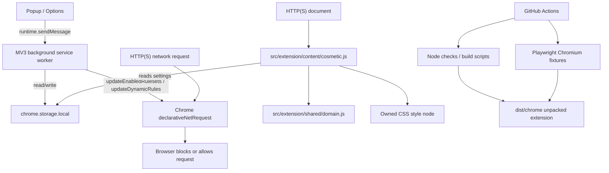
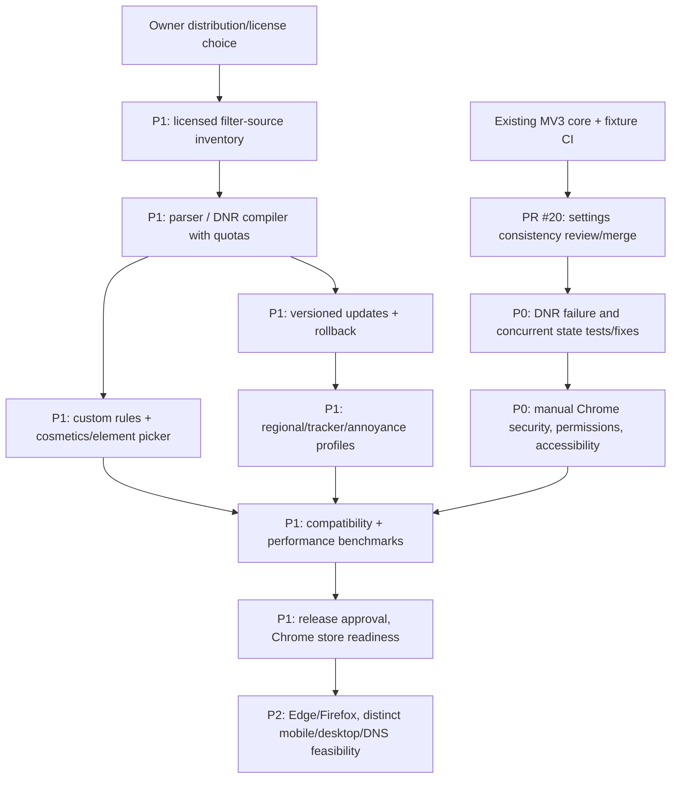

# AD BLOCKER — PERMANENT MASTER PROJECT HANDOFF

> **READ THIS FIRST in any new ChatGPT, Codex, or contributor session.**
> Updated: **2026-11-16 (Asia/Kolkata)**. Repository snapshot checked from GitHub: main at `10c877039de4f7c41122f882d731a187df6f8a0d`; PR #20 at `13176deab7b2b54d7149f67e2f85247ab16b195c`.
> Canonical repository: **https://github.com/rejoansardar23/ad-blocker**.

## 0. Purpose and scope of this archive

The owner requested a permanent, repository-native record because long ChatGPT conversations may become difficult to reopen. This file preserves the **recoverable project context and findings**: mission, source architecture, constraints, conversations summarized by topic, candidate repositories and pinned links, decisions, implementation evidence, CI commands, PRs/issues, diagrams, risks, and the exact next engineering tasks. It is designed for someone who has never seen the prior chats.

**Important provenance limitation:** This is a **consolidated reconstruction and evidence-based handoff, not a verbatim export of every chat message**. Any conversation absent from the current available context cannot be claimed to have been archived word-for-word. The public repo and its Git commits/PRs are the durable technical record. Avoid copying private credentials, support conversations, tokens, personal details, or irrelevant projects into GitHub.

### Fast-start rules for new AI coding agents

1. Fetch current `main`, `AGENTS.md`, `README.md`, this handoff, and `docs/development/START_HERE.md`.
2. Check **current branches, PRs, issues, commit SHA and CI**; the state recorded here is a timestamped snapshot, not a guarantee of today's status.
3. Read actual code before relying on docs; keep implemented, fixture-verified, manually verified, proposed, and blocked separate.
4. Never restart this as an empty repository; preserve existing code and merged history.
5. Before importing code/filter data, verify the pinned license, file-level copyright, transitives, provenance, permissions, security and benchmark value; **owner approval is still required**.
6. Prefer an independently testable fix in a small PR to a sweeping rewrite. Run `npm ci --no-audit --no-fund`, `npm run check`, `npm run build`, and `npm run test:e2e`.
7. Never merge unreviewed/failing PRs or change licensing, visibility, store publication or commercial distribution without explicit approval.

## 1. Product mission, owner constraints, and what success means

Build a **market-competitive, independently branded, privacy-first ad-blocking software platform**, first for Chrome Manifest V3, later considering Edge, Firefox and separately assessed mobile, desktop and DNS projects. Product comparisons include AdGuard, uBlock Origin / uBO Lite, Ghostery, AdBlock and Adblock Plus. Do not claim to be “number one” without dated reproducible measurements.

Prioritize real request blocking and tracker protection, minimal false positives/site breakage, low CPU/memory overhead, useful/reversible user controls, accessibility, transparent privacy, testability, safe list updates and sustainable maintenance. Conserve engineering/AI-credit costs by studying mature maintained libraries instead of needlessly recreating their functionality, **but do not combine competing filtering engines just because they exist**.

Owner constraints carried from conversations:
- Keep **one main product repository** unless separate modules/products have proven engineering justification.
- Preserve working functionality, existing branches/PRs, contributor effort and 60-step checklist; do not rewrite the application without evidence.
- No unapproved third-party code, filter-list data, scriptlets, telemetry, paid services, expanded host permissions, external servers, or remote executable JS.
- No project-wide license selection, GPL/proprietary relicensing, commercial publication, repository visibility changes, or browser-store submission without owner approval.
- Document source code vs proven Chrome behavior precisely. No fabricated blocked-ad counters, “all YouTube ads blocked” claims, or fake analytics.
- New developers and AI agents must be able to continue without past ChatGPT chat access.

## 2. Snapshot: what exists RIGHT NOW

**Main branch baseline:** `10c877039de4f7c41122f882d731a187df6f8a0d` (merged PR #19, 15 Nov 2026 UTC). A small original Chrome MV3 extension exists: `src/extension/manifest.json`, four bundled static DNR rule objects, local settings, dynamic website-exception DNR rules, reversible local cosmetic CSS, popup, options UI, structural/unit tests, Playwright Chromium fixture tests, GitHub CI and reproducible lockfile. There are **zero npm dependencies bundled into the extension runtime**; Playwright is pinned only for testing.

**Verified baseline**: [CI run 43724956889](https://github.com/rejoansardar23/ad-blocker/actions/runs/43724956889) on that exact main SHA succeeded: Node v22.23.4, Playwright 1.65.0, Chromium 158.0.8127.18; `npm ci`, `npm run check` (14/14 Node tests), `npm run build`, `npm run test:e2e` (10/10 controlled browser fixture cases), dependency SBOM, `npm audit --audit-level=high` (0 vulnerabilities reported).

**Unmerged development:** [PR #20](https://github.com/rejoansardar23/ad-blocker/pull/20), `fix/live-settings-consistency`, **OPEN DRAFT**, head `13176deab7b2b54d7149f67e2f85247ab16b195c`. Implements popup/options live settings synchronization and adds tests; also adds the large [18-repository comparative research report](https://github.com/rejoansardar23/ad-blocker/blob/fix/live-settings-consistency/docs/TWO_PRIMARY_REPOS_EVALUATION.md), ADR D-008 proposal and documentation addenda. Exact-head [CI run 43729820205](https://github.com/rejoansardar23/ad-blocker/actions/runs/43729820205) passed **20/20 Node tests**, **10/10 Chromium cases**, build and audit. **Do not describe PR #20 functionality as merged until it is.**

**Current PR history checked**:
- [#3](https://github.com/rejoansardar23/ad-blocker/pull/3) — merged 2026-11-15; Playwright real Chromium MV3 fixtures + dependency lockfile.
- [#4](https://github.com/rejoansardar23/ad-blocker/pull/4) — merged 2026-11-15; idempotent DNR reconciliation and safer cosmetic style ownership.
- [#17](https://github.com/rejoansardar23/ad-blocker/pull/17) — merged 2026-11-15; research catalog and ordered implementation queue.
- [#18](https://github.com/rejoansardar23/ad-blocker/pull/18) — merged 2026-11-15; fork-related improvements/reconciliation.
- [#19](https://github.com/rejoansardar23/ad-blocker/pull/19) — merged 2026-11-15; reconciled fork/upstream histories.
- **#20** — open draft as above. PR state must be rechecked before any work.

### What is proven vs not yet proven

| Capability | Current status and exact boundary |
| --- | --- |
| Unpacked Chrome MV3 package + service worker | Verified in synthetic Chromium CI; manual Chrome Stable UX/install gate remains |
| Network request blocking | Four static sample DNR objects; fixture blocking verified, not broad real-site filter coverage |
| Global on/off | Chromium fixtures and restart persistence verified |
| Website exceptions | Exact domain and subdomain behavior verified on synthetic fixtures; up to 100 sites |
| Cosmetic CSS | Three selector families, owned style node; fixture reversibility verified; not sophisticated filter syntax |
| Popup + options | Options browser tested; popup save behavior Node tested; actual toolbar popup accessibility unverified |
| Settings synchronization across open views | **Implemented only in PR #20**, green CI; review/merge pending |
| Filter-list parser, compiler, regional lists, subscriptions | **NOT IMPLEMENTED** |
| Safe automatic updates/rollback, advanced custom rules, element picker | **NOT IMPLEMENTED** |
| Complete tracker profiles/annoyance profiles, accurate ad counters | **NOT IMPLEMENTED** |
| Real-world compatibility, performance, independent security audit | **NOT VERIFIED** |
| Cross-browser/desktop/DNS/mobile products | Research roadmap only |

## 3. Current source tree and integration points

    .github/workflows/checks.yml   GitHub CI + artifact + SBOM + npm audit
    AGENTS.md                       Coding-agent rules
    README.md                       Project landing page
    src/extension/manifest.json                   MV3 permissions/configuration
    src/extension/background/service-worker.js    Storage/serialized DNR sync and runtime message handler
    src/extension/content/cosmetic.js             Minimal page CSS injection/removal
    src/extension/shared/domain.js                Normalize and match hostname exceptions
    src/extension/rules/starter.json              Four sample Chrome DNR block rules
    src/extension/popup/{popup.html,popup.css,popup.js}     Toolbar popup
    src/extension/options/{options.html,options.css,options.js} Settings page
    scripts/{verify.mjs,build.mjs}  Structural validation + unpacked build
    tests/unit/{domain.test.mjs,service-worker.test.mjs,
                cosmetic.test.mjs,settings-ui.test.mjs}   Node tests
    tests/browser/chromium-smoke.mjs                  Playwright tests
    docs/                            Product plan, feature matrix, 60 tasks and audits

### Browser request and settings architecture



**Source facts**:
- `src/extension/manifest.json`: Chrome MV3, minimum Chrome 121; permissions `declarativeNetRequest`, `storage`, `activeTab`; HTTP(S)-matched content script. No remote executable scripts.
- `src/extension/rules/starter.json`: four local block rules; covers limited sample domains and reserved `ads.adblocker.test` fixture, not comprehensive EasyList translation.
- `src/extension/background/service-worker.js`: `GET_STATUS`, `SET_ENABLED`, `SET_SITE_ALLOWED`; validation via `normalizeSite`; `queueSync` serializes DNR reconciliation; ruleset `starter_rules`; managed dynamic `allowAllRequests` rules; rule canonicalization avoids redundant updates.
- `src/extension/shared/domain.js`: accepts HTTP(S) DNS hostnames, exact/subdomain matches; IP literals, browser-internal URLs and arbitrary wildcards not supported for exceptions.
- `src/extension/content/cosmetic.js`: CSS for `ins.adsbygoogle`, GPT ad containers and test fixture; removes only its own injected style, never page-owned elements.
- Popup/options send background messages and display settings; baseline pages do not synchronize while simultaneously open; PR #20 adds storage-change refresh logic.
- Browser tests use a local fixture HTTP server plus `publisher.test` and `ads.adblocker.test`, verify blocked-client errors, benign requests, allowlist boundaries, pause and restart.

### Potential correctness issues — **not all reproduced bugs**

- **Confirmed source gap, PR #20 fix:** baseline open popup/options views did not react to externally changed local settings. Scoped patch + Node/Chromium checks green; awaits review and merge.
- **Potential failure-state inconsistency:** background worker writes settings *before* asking DNR APIs to reconcile; if Chrome DNR rejects a change, saved preference and actual DNR state could diverge. Must be reproduced with failure injection before treating as confirmed live defect.
- **Potential lost concurrent allowlist update:** separate request handlers may read-modify-write exception sets simultaneously; requires interleaving unit test and, if reproduced, a serialized mutation queue.
- **Potential cosmetic flash:** content script starts with defaults before asynchronous storage restore; hidden elements may briefly appear/disappear on trusted sites. Needs measured fixture.
- Broad HTTP(S) content script scope and `activeTab` need manual installation/permission and usability review. No extra permissions approved.

## 4. EXACTLY TWO primary open-source references

### PRIMARY #1 — uBlock Origin, especially the MV3/uBO Lite implementation
- GitHub: https://github.com/gorhill/uBlock
- Pinned source: https://github.com/gorhill/uBlock/tree/591b5ac8006b496b3307bcd1963b552a7b46f138
- Verified root/source license: **GPL-3.0**. Reference-only pending compatible distribution decision; no source/data import authorized.
- Source paths: `platform/mv3/make-rulesets.js`, `platform/mv3/extension/js/ruleset-manager.js`, `platform/mv3/extension/js/scripting-manager.js`, `platform/mv3/README.md`.
- Study: list-to-DNR generation, priorities, static/dynamic ID ownership, quotas, filtering modes, permission-scoped scripts, exceptions, browser-specific builds, regression design.
- Also useful generated artifact (secondary, NOT a third primary): https://github.com/uBlockOrigin/uBOL-home/tree/a58a26f1f76c9d880f406c53cbe4cb7f3e284e36

### PRIMARY #2 — Ghostery Adblocker SDK
- GitHub: https://github.com/ghostery/adblocker
- Pinned source: https://github.com/ghostery/adblocker/tree/6f0610bf5eec1f31c4975ce0e707cdf47023e5b5
- Verified root/core license: **MPL-2.0**, core package `@ghostery/adblocker` at **2.20.3**. Needs transitive, file-level and distribution review.
- Source paths: `packages/adblocker/src/engine/engine.ts`, `packages/adblocker/src/lists.ts`, `packages/adblocker/src/filters/network.ts`, `packages/adblocker-webextension/src/index.ts`.
- Study: filter syntax/parser boundaries, exception semantics, bucket indexing, cosmetics, incremental list/state handling.
- **Not a drop-in Chrome MV3 solution:** inspected webextension adapter uses WebRequest-based concepts; a separate robust list-to-DNR compiler and browser quota handling would be required. Avoid creating a second request-blocking engine.

**Preferred design:** KEEP original Chrome native-DNR runtime; use these two as deep study boundaries, possibly evaluate a narrow build-time parser later. Do not replace working code or import either project's licensing obligations silently. Decision is **proposed ADR D-008**, owner distribution licensing still pending.

The 18-repository comparison, score rubric and deeper technical notes are also in PR #20's `docs/TWO_PRIMARY_REPOS_EVALUATION.md` (not on main until that PR merges). The complete original candidate catalog is already on main: [OPEN_SOURCE_REFERENCE_REPOS.txt](../research/OPEN_SOURCE_REFERENCE_REPOS.txt).

## 5. All 18 previous repository research links and pins

These are **study candidates, not integrated dependencies**. Root license is not a legal opinion on every file/list; EasyList list-level rights remain unresolved.

| # | Repo / exact pinned link | Root license | What to investigate / decision |
|---|---|---|---|
| 01 | [chrisbbreuer/very-good-adblock](https://github.com/chrisbbreuer/very-good-adblock/tree/9f8fc91262c1bd0e92fa382b5c457b773b5fd5c0) | MIT; **bundled/generated GPL-labeled lists** | TypeScript DNR; expensive Bun/Stacks adaptation; do not copy list bundle |
| 02 | [adyoi/unblock](https://github.com/adyoi/unblock/tree/2cdca77654634aa535bda650bf7b20835d767fc4) | MIT | MV3 picker/scriptlets/remote list; requests tabs, scripting, userScripts, unlimitedStorage, all-URL access; no blind adoption |
| 03 | [Dabrogost/Chroma-Ad-Blocker](https://github.com/Dabrogost/Chroma-Ad-Blocker/tree/a85f1a8e017c7843d3cd973855720cd3a8fcbfed) | GPL-3.0 | Experimental MV3/related routing reference |
| 04 | [AdguardTeam/AdguardBrowserExtension](https://github.com/AdguardTeam/AdguardBrowserExtension/tree/69965fa59a5d5a44531768780850d3e788fa93e1) | GPL-3.0 | Full competitor/feature and test model; reference only |
| 05 | [gorhill/uBlock](https://github.com/gorhill/uBlock/tree/591b5ac8006b496b3307bcd1963b552a7b46f138) | GPL-3.0 | **Primary #1**, MV3 compilation/permissions architecture |
| 06 | [uBlockOrigin/uBOL-home](https://github.com/uBlockOrigin/uBOL-home/tree/a58a26f1f76c9d880f406c53cbe4cb7f3e284e36) | GPL-3.0 | Generated Chromium MV3 reference and side-by-side source artifact |
| 07 | [ghostery/ghostery-extension](https://github.com/ghostery/ghostery-extension/tree/8854d665120e8085fedffbf06327995b55efa7f5) | GPL-3.0 | Tracker/privacy UX benchmark only |
| 08 | [ghostery/adblocker](https://github.com/ghostery/adblocker/tree/6f0610bf5eec1f31c4975ce0e707cdf47023e5b5) | MPL-2.0 | **Primary #2**, parsing/filter semantics |
| 09 | [brave/adblock-rust](https://github.com/brave/adblock-rust/tree/4d525b7c6dce1608aa192e771524f0406f4d1a39) | MPL-2.0 | Native/WASM engine future feasibility |
| 10 | [wxt-dev/wxt](https://github.com/wxt-dev/wxt/tree/f9fa638f895f58b1054813f055949b23e3899e26) | MIT | Extension framework only if migration measurements justify it |
| 11 | [AdguardTeam/AGLint](https://github.com/AdguardTeam/AGLint/tree/a4d3e4515c124d50faf19b901269b6dd70e02068) | MIT | Offline filter syntax validation |
| 12 | [AdguardTeam/DiffBuilder](https://github.com/AdguardTeam/DiffBuilder/tree/c8a7daef6cef8d515801786856d28aabb619809c) | MIT | Future efficient list-delta tooling |
| 13 | [shadcn-ui/ui](https://github.com/shadcn-ui/ui/tree/e62c9435fff729a175f38983dee73b2cb4f6a069) | MIT | Optional dashboard/UI primitives, not a required framework migration |
| 14 | [microsoft/playwright](https://github.com/microsoft/playwright/tree/b4d016aadc5cbd2b898a284307975fe73e05483d) | Apache-2.0 | Already integrated as dev-only Playwright 1.65.0 |
| 15 | [easylist/easylist](https://github.com/easylist/easylist/tree/3ee6b5fce83b9fa238374dee71de37fa5c0e5a20) | **UNKNOWN list-level terms** | Ads/privacy/filter data; verify redistribution individually |
| 16 | [StevenBlack/hosts](https://github.com/StevenBlack/hosts/tree/35c74714ad86b36806b3f40f3c36abf8b2063cb5) | MIT root; upstream data separately | Domain feed research; does not support cosmetics alone |
| 17 | [hagezi/dns-blocklists](https://github.com/hagezi/dns-blocklists/tree/8c023c4a80650d7852181c4035c9b6d3a16cd01e) | GPL-3.0 | Separate DNS, data and policy study |
| 18 | [ajayyy/SponsorBlock](https://github.com/ajayyy/SponsorBlock/tree/8cdda0b0b04de6f9cfe444031f035c1218c7da3b) | GPL-3.0 | Possible later sponsor-segment feature; API/database rights separate |

**Honest research limits:** All 18 exact repository HEAD revisions/top-level source trees were checked, 17 root license files were read, and selected filtering modules were inspected. No complete audit of 18 full codebases, transitive dependency license scan, candidate build, reproducible competitor performance benchmark or commercial legal clearance was completed. “Newest” pins reflect **15 Nov 2026 research**, not perpetual current HEAD.

## 6. Licensing/security and MV3 rules

- Public GitHub repository ≠ permission to distribute source/code/data under arbitrary terms. Our own repository has **no approved project-wide distribution license yet**; owner must decide proprietary/source-available/open-source approach and contribution/attribution terms.
- GPL extension source and independently licensed filter lists must not be folded into a desired proprietary build without legal compatibility and owner approval. MIT and MPL may be candidates with relevant notices/source-file obligations; evaluate actual binaries and dependencies.
- Chrome MV3 uses `declarativeNetRequest`: browser processes matching rules; no unrestricted `webRequestBlocking` equivalent in standard consumer MV3; actual static/dynamic limits, safe/unsafe rules, priorities and site permission boundaries should be checked against official Chrome API docs on the target version.
- Do not fetch/execute remote JavaScript via updates, scrape user browsing history, introduce telemetry or upload rules/user data to unapproved services. Source-list integrity, verification and rollback are P1 work.
- Run negative fixtures for benign requests, trusted-site subdomains, invalid domain inputs, unsupported filter syntax, bad update signatures, browser failure and performance/regressions.

**Official engineering references:**
- Chrome DNR: https://developer.chrome.com/docs/extensions/reference/api/declarativeNetRequest
- MV3 migration: https://developer.chrome.com/docs/extensions/develop/migrate/what-is-mv3
- Chrome Web Store policies: https://developer.chrome.com/docs/webstore/program-policies/
- Playwright extension testing: https://playwright.dev/docs/chrome-extensions
- SPDX licenses: https://spdx.org/licenses/
- GitHub Actions baseline: https://github.com/rejoansardar23/ad-blocker/actions/runs/43724956889
- PR #20 CI: https://github.com/rejoansardar23/ad-blocker/actions/runs/43729820205

## 7. 60-step implementation checklist state and roadmap

The authoritative 60-item list is [docs/product/IMPLEMENTATION_CHECKLIST.md](../product/IMPLEMENTATION_CHECKLIST.md); do not replace its status based on chat claims. At snapshot:
- **001–003**: docs/project governance artifacts created.
- **004–010**: licensing, full candidates review, benchmark and approved ADR **open**; some source research completed but license/measurement gates remain.
- **011–018**: original MV3 source, starter rules, worker, popup/options, Node scripts/tests, workflow present.
- **019–023**: CI/controlled Chromium functionality verified; not a production release claim.
- **024–025**: manual security/accessibility/permission review and alpha ZIP **open**.
- **026–060**: planned, with Stage 2 mature filtering, Stage 3 privacy/UI/release, Stage 4 benchmarks, Stage 5 expansion all **not complete**.
- PR #20 additional settings synchronization is **pending** until merged and revalidated on main.

### Dependency-aware roadmap



| Tier / issue | Current action and acceptance criteria |
| --- | --- |
| P0 [#5](https://github.com/rejoansardar23/ad-blocker/issues/5) | Review PR #20; then reproduce/reconcile worker DNR/storage failures and concurrent allowlist writes. Run Node + Chromium checks. |
| P0 [#2](https://github.com/rejoansardar23/ad-blocker/issues/2) | Ask owner to decide license/distribution; complete source/data legal security audit and approve ADR. No third-party imports until approved. |
| P1 [#6](https://github.com/rejoansardar23/ad-blocker/issues/6) | Pinned legal filter-source manifest, upstream notices, exact hashes, supported formats. |
| P1 [#7](https://github.com/rejoansardar23/ad-blocker/issues/7) | Tested list-to-DNR compiler with quotas, exception precedence and unsupported-syntax report. |
| P1 [#8](https://github.com/rejoansardar23/ad-blocker/issues/8) | Rule/list update integrity checks, last-good rollback and offline recovery. |
| P1 [#10](https://github.com/rejoansardar23/ad-blocker/issues/10) | Custom filters, exceptions, settings migration/export/import, undo and invalid-input tests. |
| P1 [#9](https://github.com/rejoansardar23/ad-blocker/issues/9) | Advanced safe cosmetics, dynamic DOM and reversible accessible element picker. |
| P1 [#11](https://github.com/rejoansardar23/ad-blocker/issues/11) | Tracker, nuisance and regional profiles with source attribution and breakage suite. |
| P1 [#12](https://github.com/rejoansardar23/ad-blocker/issues/12) | Accessible controls, honest diagnostics, error recovery and privacy UX. |
| P1 [#14](https://github.com/rejoansardar23/ad-blocker/issues/14) | Versioned comparable coverage/false-positive/CPU/memory competitor benchmarks. |
| P1 [#13](https://github.com/rejoansardar23/ad-blocker/issues/13) | Release readiness, security/privacy review, zip, change log; store publication requires owner approval. |
| P2 [#15](https://github.com/rejoansardar23/ad-blocker/issues/15), [#16](https://github.com/rejoansardar23/ad-blocker/issues/16) | Cross-browser adaptation and separate desktop/DNS feasibility. |

## 8. Complete local & CI validation recipes

```bash
git clone https://github.com/rejoansardar23/ad-blocker.git
cd ad-blocker
git status --short
git rev-parse HEAD
git branch -a
npm ci --no-audit --no-fund
npm run check
npm run build
npx playwright install chromium
npm run test:e2e
```

Browser fixture environment uses a persistent Playwright Chromium profile and its bundled Chromium (not Chrome Stable channel), local synthetic server and host resolver mappings; test scope is not a live ad-network benchmark.

After a PR changes code, check **checks for the exact new commit**. Preserve `package-lock.json` as generated; do not claim an unrun local command passed simply because CI did.

## 9. Relevant canonical repository documents

| File | Read for |
| --- | --- |
| [AGENTS.md](../../AGENTS.md) | Mandatory coding-agent rules |
| [README.md](../../README.md) | Onboarding and current supported claims |
| [START_HERE.md](../development/START_HERE.md) | Developer first steps |
| [ARCHITECTURE.md](../architecture/ARCHITECTURE.md) | Code boundaries, runtime flow, constraints |
| [VISION.md](../product/VISION.md) and [PRODUCT_SPEC.md](../product/PRODUCT_SPEC.md) | Goals, use cases and acceptance requirements |
| [FEATURE_MATRIX.md](../product/FEATURE_MATRIX.md) | Implemented vs verified vs planned |
| [ROADMAP.md](../product/ROADMAP.md) | Stage exit gates |
| [IMPLEMENTATION_CHECKLIST.md](../product/IMPLEMENTATION_CHECKLIST.md) | All 60 ordered tasks |
| [PR_EXECUTION_QUEUE.md](../development/PR_EXECUTION_QUEUE.md) | Issue dependency order and PR workflow |
| [FOUNDATION_AUDIT.md](../research/FOUNDATION_AUDIT.md) | Reuse audits, legal blockers |
| [REUSE_AND_LICENSES.md](../governance/REUSE_AND_LICENSES.md) | No-import policy, notice obligations |
| [DECISIONS.md](../governance/DECISIONS.md) | ADRs and decisions still pending |
| [OPEN_SOURCE_REFERENCE_REPOS.txt](../research/OPEN_SOURCE_REFERENCE_REPOS.txt) | Original 18 candidates |
| [CODEX_WORKFLOW.md](../development/CODEX_WORKFLOW.md) | Cost-efficient agent workflow |
| [RESEARCH_BACKLOG.md](../research/RESEARCH_BACKLOG.md) | Unverified questions |
| [TESTING.md](../testing/TESTING.md) | Test commands and limitations |
| [COMPETITIVE_BENCHMARK.md](../research/COMPETITIVE_BENCHMARK.md) | Reproducible future benchmark methodology |
| [CHROMIUM_TEST_GUIDE.md](../testing/CHROMIUM_TEST_GUIDE.md) | Browser fixture guidance |
| [RELEASE_GUIDE.md](../development/RELEASE_GUIDE.md) | Approval-gated release requirements |

**Additional deeper report currently in draft PR #20**: [TWO_PRIMARY_REPOS_EVALUATION.md](https://github.com/rejoansardar23/ad-blocker/blob/fix/live-settings-consistency/docs/TWO_PRIMARY_REPOS_EVALUATION.md). It includes a provisional 7-candidate weighted score table (measured performance UNKNOWN), primary source links and ADR D-008. If #20 merges, prefer the main-branch version of this report.

## 10. Exact next developer / new-chat prompt

> You are continuing my EXISTING Chrome MV3 ad-blocker at https://github.com/rejoansardar23/ad-blocker. **First read docs/history/MASTER_PROJECT_HANDOFF.md and AGENTS.md completely**, then check current main, open PRs, CI, issues, source and 60-step checklist. The repository has a working original DNR/cosmetic/settings foundation. Do not rebuild it, merge overlapping engines or assume documentation-only functionality is shipped. As of the handoff snapshot, PR #20 (cross-window popup/options sync plus 18-repository research/ADR) was an OPEN DRAFT at 13176deab7b2b54d7149f67e2f85247ab16b195c with green exact-head CI. Review that status and proceed in priority order. Two and only two primary deep reference repos are gorhill/uBlock (GPL-3.0 MV3 source, reference-only) and ghostery/adblocker (MPL-2.0 parser study, potential conditional narrow build-time use). No project-wide license, commercial release or upstream code/list data import is approved. For each eligible improvement: reproduce evidence, modify minimal code, add unit and Chromium tests, run npm ci/check/build/test:e2e, open a focused PR, verify its exact commit CI and update docs. Flag owner licensing decisions separately. Keep replies tied to actual links, files, commits and test results.

## 11. Maintaining this durable context

Whenever a scoped PR is merged, update this file's date/commit/status and canonical docs in the same PR or a follow-up docs-only PR. Link permanent GitHub source rather than unreliable chat URLs, avoid repeating large transcripts, and distinguish observed facts from recommendations. For historical conversational decisions, see [RESEARCH_AND_CHAT_HISTORY_ARCHIVE.md](RESEARCH_AND_CHAT_HISTORY_ARCHIVE.md). The source of truth for the current repository remains **main + merged PRs + exact-commit CI**, not this timestamped snapshot alone.
